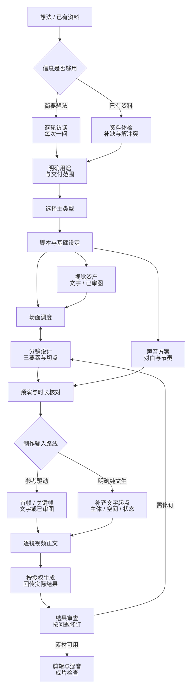

# AIGC_Lab · AI 影像创作实验室

把一句想法或完整 PRD，逐步变成**可以制作的脚本、调度、分镜和可复制的图片／视频提示词**。重点打磨多角色剧情短片与 AI 漫剧，同时覆盖广告、科普、口播、纪实、音乐、产品演示、氛围艺术和混剪。

项目采用 **1 个总控 + 10 个共享节点 + 9 个类型模块**。专业能力包括具体镜头数与节奏设计、张力变化、演员表演物理化、空间与道具连续性、角色三／四视图、首帧与动态分工。单张图片保留短流程。

本轮套件的实际演练与检查状态见 [训练记录](06_实验与复盘/2026-10-16_Skill链训练/README.md)。**文字检查、模型适配、媒体生成和成片验收分别记录**；不能把 skill 文件创建或格式通过称为视频生成成功。

v1已完成31例文字演练与独立审查、101项测试及隔离安装验证。当前版本同时提供全链路 Skill 和项目持续迭代机制；原套件发布见[预览与发布记录](06_实验与复盘/2026-10-16_Skill链训练/preview.md)，两套流程的整合见[main合并记录](spec/plans/2026-10-16-main合并与迭代机制整合.md)。用户级安装仍需按使用说明单独同步。

想直接看输出效果，可先读[30秒剧情片完整文字包（修订版）](06_实验与复盘/2026-10-16_Skill链训练/example-chain-v002.md)，其中有角色三视图、调度、6镜分镜、逐镜首帧/视频正文、声音和剪辑。它是训练示例，尚未生成媒体。

## 怎样开始使用

安装完整套件后，在 Codex 中打开本项目，给总控你的需求：

```text
请使用 $aigc-creator。
我想做一个多角色剧情短片：A和B争吵，B委屈地哭了。
先每次问我一个关键问题，完善PRD，再按合适的节点继续。
本轮只准备制作资料和提示词，不调用媒体生成。
```

已有完整资料时可以直接指定下一步：

```text
请使用 $aigc-creator。读取我提供的完整PRD、人物设定和脚本，
检查是否足够进入场面调度；足够就直接继续，不重新开展完整访谈。
输出调度、分镜、首帧与逐镜视频提示词，分别给可复制正文。
```

可以单独调用某节点，例如 `$aigc-blocking`、`$aigc-keyframes`；也可以直接指定类型入口 `$aigc-commercial`。新技能如果尚未出现在当前会话列表中，重启 Codex 后核对。允许自动匹配不等于任何表述都必然触发；总控会读取具体模块与节点的规则。

**不保存**：只在聊天交付；**不入库**：作品内部资料按授权保存，但不写公共经验索引、提示词库或模型库；**只做某一步**：裁剪工作范围。缺少影响创作的关键决定时才追问，普通已授权步骤继续执行。

## 主流程



这是完整视频的默认路线，实际按用途与已有材料裁剪。前置经验检索与每轮结束/暂停时的反馈贯穿这条路线，具体见下方持续迭代说明；文字交付也要复盘，不必等实际成片：

- 视觉概念可以与脚本并行；角色、服装和道具定稿需要匹配剧情。已有适用参考资产直接继承。
- 调度决定人物怎样站、走、看和接触；分镜决定观众从哪里看、看多久、何时切。两者需要往返校对。
- 声音在脚本阶段介入，避免对白到后期才发现放不进镜头；最终音轨和混音在素材成形后核对。
- 无人物的产品、环境或抽象影像不强制做角色三视图；实际录屏不替换为虚构UI；纯文生视频不强制先出图。
- 每一步都有文字审查。只有实际授权生成并检查媒体后，才能推进生成／成片状态。

**交付范围与制作路线分开。** “只生成提示词”只限制本轮执行生成。完整多镜头创作仍交所需角色/场景/道具参考图正文、调度与分镜、逐镜静态首帧正文和动态正文；当前无图时将资产与首帧标为文字候选，真实图像绑定待生成及审查。用户明确纯文生、只要某节点或已有适用资产时再按范围裁剪或复用。媒体制作时先取得经检查的参考资产和首帧，再进入相应视频生成。

套件1.0.1的本次纠正与实际示例见[《钥匙在谁手里》主流程补齐](06_实验与复盘/2026-10-16_全局Skill加载与剧情路由实测/README.md)。上轮纯文生案例作为历史证据保留，不代表完整参考资产流程已测试。本次main提交范围与验证见[1.0.1发布核对](06_实验与复盘/2026-10-16_全局Skill加载与剧情路由实测/发布核对_1.0.1.md)。

## 视频类型如何归类

目录按**用途与验收目标**分类。真人／2D／3D／定格、横屏／竖屏、对白／旁白、文生／图生是独立维度，不各复制一套 skill。以下覆盖常见用途，不宣称行业只有九种类型。

| 模块与入口 | 适合内容 | 该模块重点检查 |
|---|---|---|
| [剧情与漫剧](skills/modules/narrative/README.md) · `aigc-narrative` | 多角色短片、微短剧、人物小品、AI 漫剧 | 人物目标、行动因果、张力、表演与跨镜连续性 |
| [商业广告](skills/modules/commercial/README.md) · `aigc-commercial` | 商品广告、品牌片、电商、企业／文旅／活动宣传 | 产品识别、外观、传播重点、宣传主张与证据 |
| [科普讲解](skills/modules/explainer/README.md) · `aigc-explainer` | 知识短片、机制说明、课程、数据解释 | 教学目标、事实、类比边界、图像是否准确 |
| [数字人口播](skills/modules/presenter/README.md) · `aigc-presenter` | 虚构讲师、主持、面对镜头解说、人物介绍 | 可讲述性、声音节奏、手势、身份与口型 |
| [纪实与重建](skills/modules/documentary/README.md) · `aigc-documentary` | 纪实、人物采访、历史说明、情景重建 | 事实与来源、真实素材和生成重建的明确区分 |
| [音乐视觉](skills/modules/music/README.md) · `aigc-music` | MV、歌词视觉、节拍动画、音乐叙事 | 音轨结构、拍数与时长、节奏和视听关系 |
| [产品演示](skills/modules/product-demo/README.md) · `aigc-product-demo` | 软件录屏、功能演示、使用步骤、操作教学 | 真实UI／功能证据、步骤、等待与可见结果 |
| [氛围艺术](skills/modules/visual-art/README.md) · `aigc-visual-art` | 环境短片、抽象视觉、循环、背景板、展陈 | 视觉主变量、运动规律、首尾接点与显示条件 |
| [混剪与预告](skills/modules/montage/README.md) · `aigc-montage` | 已有素材混剪、活动回顾、预告、再编排 | 素材清单、入出点、信息顺序、声音与素材缺口 |

**其他类型不一定要新建整套 skill。** 例如“竖屏3D咖啡广告”采用商业模块，加竖屏和3D表现约束；“带剧情的商品广告”以商业为主、剧情为辅。只有出现新的专属输入、创作判断或验收方法时，才新增模块或专用节点。

## 十个共享创作节点

| 节点 | 输入重点 → 实际交付 |
|---|---|
| [aigc-prd](skills/core/aigc-prd/SKILL.md) | 简要需求／已有PRD → 创作需求书、确认/假设/待定、交付标准 |
| [aigc-script](skills/core/aigc-script/SKILL.md) | PRD与基本设定 → 分场脚本、行动/信息节拍、对白、镜头数量建议 |
| [aigc-visual-assets](skills/core/aigc-visual-assets/SKILL.md) | 角色与场景需求 → 三／四视图、服装／场景／道具规范及图片正文 |
| [aigc-blocking](skills/core/aigc-blocking/SKILL.md) | 脚本与空间设定 → 站位、动作、视线、接触、相机观察方向和起止状态 |
| [aigc-storyboard](skills/core/aigc-storyboard/SKILL.md) | 脚本与调度 → 具体镜头数、景别、运镜、画面、时长、张力与切点 |
| [aigc-keyframes](skills/core/aigc-keyframes/SKILL.md) | 镜头与已选资产 → 确定瞬间的首帧／必要尾帧／关键姿态图片正文 |
| [aigc-video-prompts](skills/core/aigc-video-prompts/SKILL.md) | 分镜、输入方式、起始状态 → 动作链、摄影机路径、声音和结束状态正文 |
| [aigc-audio](skills/core/aigc-audio/SKILL.md) | 对白、人物表演、事件节拍 → 配音稿/指导、环境声、音效、音乐与声音衔接 |
| [aigc-editing](skills/core/aigc-editing/SKILL.md) | 镜头计划／真实素材和音轨 → 入出点、保留时长、转场、字幕、混音与输出计划 |
| [aigc-review](skills/core/aigc-review/SKILL.md) | 当前资料／真实结果 → 有证据的问题、修复提示词、责任节点与复查范围 |

三／四视图属于视觉资产。三视图可约定正面、侧面、背面；四视图可约定正面、左侧、右侧、背面，按不对称细节和实际用途明确选择。它们与“3/4侧角度”不同。首帧只描述一瞬间，后续伸手、转身、表情变化和运镜进入动态正文。

## Skill 怎样衔接

六条共同规则已写入 [项目 AGENTS](AGENTS.md)，详细交接见 [共同协议](skills/aigc-creator/references/handoff.md)。总控的实际选择逻辑见 [路由规则](skills/aigc-creator/references/routes.md)。

1. 每个节点说明输入、输出、完成标准和缺项处理，只补本步必要缺口。
2. 共用角色、服装、场景、道具、镜头的固定 ID，以及同一份已确认设定。
3. 同时交付可检查的创作结果和干净的发送正文；编号、版本、上传说明留在正文外。
4. 上游改变时按依赖复查下游，保留历史，不自动重做整片。
5. 计划与生成实际分开；后段根据经检查的真实状态衔接。
6. 统一创作内容，按实际平台、模型版本、入口和输入能力适配。

**交接示例：** 脚本确定“解释失败后落泪”；调度明确B站在桌右、看向左侧A；分镜选择眼平近景缓慢推进；首帧保留尚未落泪的起点；视频正文写吸气、短句、抿唇、目光与落泪；声音节点安排语气和停顿；下镜继承泪痕与站姿。若生成结果中B已经坐下，先决定修正还是接受，再更新受影响的后段。

交接摘要记录：作品/版本、主模块、阶段、输入来源、确认/假设/待定、资产、镜头及三要素、起止状态、下游依赖、检查与下一步。已有字段引用原文件，不另造重复事实表。

## 你会拿到哪些文件

| 内容 | 位置 |
|---|---|
| 用户需求、PRD、确认/待定、下轮起点 | 作品 `00_创作需求.md` |
| 人物、衣装、场景、道具规范 | `01_故事与角色设定.md` |
| 剧情／信息脚本、对白与节拍 | `02_剧情脚本.md` |
| 逐镜资料与图片／视频正文 | `03_分镜表.csv` |
| 纯净可复制正文 | `04_生成提示词/本次发送.md`；候选另放草案 |
| 实际生成输入、参数、媒体 | `05_生成结果/` |
| 修改与范围明确的审查证据 | `06_修改与验收.md` |
| 母版／计划／实际状态 | `07_连续性台账.md` |
| 片段、剪辑时长与衔接 | `08_分段与衔接.md` |

调度、声音、张力和剪辑细节按需要放在相应 Markdown 专节或补充文件；保留现有分镜 CSV 表头和历史作品。训练用例与执行输出放复盘目录，不登记成已完成真实作品。

## 提示词与专业资料

- [用户三截图原件与拆解](skills/aigc-creator/references/screenshot-analysis.md)：镜头条目、调度混合稿、首帧＋连续动作的分工。
- [导演语言方法](skills/aigc-creator/references/prompt-language.md)：一句话怎样变成具体镜头、张力、动作与表演。
- [56条画面/表演语言](skills/aigc-creator/references/lexicon.md)：词语的可见作用、适用条件和冲突，初始条目未做媒体实测。
- [真实电影案例](skills/aigc-creator/references/film-cases.md)：6个有来源的案例，区分资料证实与方法迁移。
- [模型适配记录](skills/aigc-creator/references/model-adaptation.md)：Seedance与Runway的具体版本/输入规则，核验日期与未验证范围。
- [原有12类、60条提示词模块](02_提示词库/分类模块/00_使用索引.md)：按需检索、查重与复用；模块状态以各记录为准。

重要主体、动作与硬约束前置，这是已获用户确认的编排原则，不是所有模型的位置权重定律。修饰词要服务可见结果；复杂场面要有角色目标、空间、触发和接触关系。镜头的三要素始终是**相机、角色/主体、画面**，并补齐前后衔接。

## 安装、更新与分类分发

源目录按用途归类，安装目录按唯一 skill 名平铺。总控保存共享资源，其他19个skill依赖它；安装一个叶节点时不能漏掉总控。完整清单见 [skills/catalog.json](skills/catalog.json)。

```text
skills/
├─ aigc-creator/          总控、共享协议、原截图、语言库、来源资料
├─ core/aigc-*/          10个共享节点
├─ modules/
│  ├─ narrative/         剧情模块及其专属skill
│  ├─ commercial/        广告模块及其专属skill
│  └─ ...                另外7个用途模块
└─ catalog.json          唯一名称、路径、分类与安装依赖
```

在项目根目录运行，Python 3.10+，仅用标准库：

```powershell
# 检查整套源码、名称、依赖及包内链接
python -X utf8 scripts/skill_bundle.py validate

# 默认只显示计划，不写入安装目录
python -X utf8 scripts/skill_bundle.py install --target "$env:USERPROFILE\.codex\skills"

# 确认计划后首次安装
python -X utf8 scripts/skill_bundle.py install --target "$env:USERPROFILE\.codex\skills" --apply

# 更新已有版本：先在目标目录外备份将覆盖的文件
python -X utf8 scripts/skill_bundle.py install --target "$env:USERPROFILE\.codex\skills" --apply --update
```

同名内容不同而未指定更新时，整批不写。未知额外文件保留并报告；源与安装副本不会自动双向同步。更新前先检查输出中的差异和备份位置。安装后核对技能列表；尚未刷新时重启。完整说明见 [安装与使用](05_工具与模型适配/AIGC创作Skill使用说明.md)。

在已明确的完整项目中，各skill优先读该项目的配套资料；脱离项目再读配套安装包。这样不会把新工作树的节点与旧全局总控混接。源文件存在、安装复制成功、当前会话自动触发是三个不同的验证层次。

## 持续迭代：让下一次创作使用上一次的经验

**操作入口：[持续迭代使用指南](06_实验与复盘/持续迭代使用指南.md)**。包含开始创作、反馈一稿、复盘回写和下一轮复用的可复制口令。

本项目采用“创作前检索 → 本轮使用 → 创作后复盘 → 验证改法 → 更新经验 → 下轮再用”的方法。Codex 执行创作任务时按项目规则完成这些步骤；没有任务运行时不会在后台自行学习。积累的是文件中的经验与方法，不是重新训练模型。

[经验索引](06_实验与复盘/经验索引.md)是统一入口，完整状态和执行规则见[持续迭代规则](spec/持续迭代.md)。索引建立时为零条，已有作品的记录不会被自动标为有效经验；后续按实际反馈和证据登记，允许零新增。

现在已有一个真实的文字创作闭环：[《先做一小步》v001→v002](06_实验与复盘/2026-10-16_WORK-003_持续迭代闭环.md)。第一轮从空索引开始，独立复盘后登记 EXP-001 候选，第二轮先检索再实际采用，最后只把有证据的文字交接范围升级；没有生成媒体或验证观众效果。以后怎样开始、反馈、复盘和复用，见[持续迭代使用指南](06_实验与复盘/持续迭代使用指南.md)。

### 从第一性原理推导每一次改动

先从**想改变的结果、已知事实和真实约束**推导下一步，再判断经验和模板是否适用。经验提供候选做法，不能代替当前任务的判断；已确认的创作原则如需改变，先说明取舍并询问用户。

| 步骤 | 先回答什么 | 留下什么 |
|---|---|---|
| 1. 定义结果 | 给谁看，希望观众理解、感受或做什么？本轮怎样判断达到目标？ | 一个具体改进目标，以及不能改变的内容 |
| 2. 还原事实与约束 | 哪些已观察到？哪些只是解释或假设？时长、素材、授权、预算有哪些限制？ | 事实、假设、未知项分开；用户已确认与 Agent 工作假设分开 |
| 3. 找最小瓶颈 | 哪个尚未解决的条件最妨碍目标？它属于需求、剧情、调度、提示词还是后期？ | 指向具体镜头/文件的证据与最小修订范围；没有缺陷也可保留原稿 |
| 4. 先写可检查的假设 | 在条件C下，把A改成B，预期会出现什么变化？哪些结果会否定这个判断？ | 修改前原稿、预定判据、不变项和适用条件；检索经验并核对条件 |
| 5. 做最小一轮并对照 | 实际改了什么？结果有帮助、无变化、变差还是尚未执行？ | 新版本与独立复核；多处同时变化时分开记录，不把全部效果归因于一条经验 |
| 6. 按证据沉淀和停止 | 证据究竟支持到哪里？下一任务能否复用？当前是否已达标，或必须等待真实媒体/反馈？ | 先保存结果再更新经验；注明范围、反例和下轮起点；无新证据允许零新增 |

《先做一小步》中，“看完知道怎么做”是用户新增目标，不能倒推原稿失败。独立审查另发现编辑镜头缺光标前提，于是提出并实际试用“起始文本、光标/选区、操作、目标文本”四项交接；字符推演通过只支持本例的文字操作确定性。观众是否学会、真实软件是否如此响应、媒体是否合格，分别需要对应证据。

日常可以直接说：

```text
这轮要改善【结果】，保留【不可改变的约束】。
请先区分事实、假设和未知，定位最小瓶颈，核对相关经验。
修改前写清判据并保存原稿，只改受影响部分；完成后对照结果和反例。
只把证据支持的方法与条件写回经验，留下下轮起点。
本轮只准备文字和提示词，不调用媒体生成。
```

| 时机 | 执行过程 | 保存位置 |
|---|---|---|
| 开始创作或续作 | 读取需求、当前版本和范围；按类型、模型、风格、问题查经验，核对适用条件 | 作品内部记录采用/试用的经验 ID + 版本、理由、判定方法；无匹配就如实记录 |
| 制作与修改 | 只采用适用的方法；保留用户反馈、实际输入输出与对应镜头，分开事实和原因假设 | 作品资料、生成记录和修改记录 |
| 本轮结束或暂停 | 逐条记录有帮助、无变化、变差或未执行；提炼下一次可验证的问题 | 作品 06_修改与验收.md；必要时用[实验记录模板](06_实验与复盘/实验记录模板.md) |
| 有新结论或反例 | 查重，先写来源和证据；更新实际变化的模块/模板/模型条件，最后更新经验索引 | 提示词表达进提示词库，模型条件进适配目录，详细试验留复盘；纯复用不写公共流水账 |
| 下一轮 | 重新核对状态和条件，优先使用适用的已验证经验，对候选或待复验项有标注地试用 | 保留本轮效果记录，继续收窄或扩展有证据支持的范围 |

经验有四种状态：**候选、已在指定范围验证、待复验、停用**。每次验证写清范围、执行者、日期、样本与证据；模型或条件变化、出现反例时重新审查，旧版和失败记录保留。文本检查通过只能支持文本/流程结论，关联提示词没有实际媒体结果时仍是“未实测”，也不会自动把作品改成已生成或已验收。

例如，实际生成中发现动作未完成，可以提出“减少一个镜头中的动作数量”作为候选改法；在已有授权范围内进行比较，保存输入与输出，再按真实结果决定保留、调整或停用。这个例子只是方法说明，不是本项目已经验证的经验。

你可以照常描述创作需求，也可以直接说：

```text
开始前查一下经验索引，只采用适合本次作品的经验。
本轮结束后记录哪些有帮助、哪些还没验证，并留下下轮改进点。
```

在外部平台生成后，可以提供实际结果和具体反馈，供本项目记录与审查。仅有口头反馈会标明来源，不会冒充 Agent 已播放或目视检查。“不保存”时只在聊天复盘；“不入库”时只按授权保留作品内部记录。审美偏好默认只对本作品生效，明确要求以后沿用才登记为项目偏好。

本流程由本项目 [AGENTS.md](AGENTS.md)接入，沿用现有 Skill 的项目读取流程。旧作品不批量补填或重写，后续创作才开始记录本轮经验使用情况。实现过程、保留范围和本地验收结果见[本轮执行计划](spec/plans/2026-10-16-持续迭代流程.md)。


## 每个 Skill 后续怎样打磨

这一节用于明确授权的 Skill 维护任务。日常创作先按上节把反馈记录到作品、实验与经验索引；对语言库、电影案例或 Skill 指令的改进先形成待维护建议，不自动改写 `skills/` 中的文件。

固定采用：**保存真实请求与原始答复 → 找到具体缺口 → 修改最少规则/例子 → 独立执行 → 陌生题材复测 → 有媒体时补实际试拍**。记录输入、版本、实际输出、问题位置、修改原因和证据；不为证明新版本更好而捏造旧版失败。

| 节点 | 正常案例重点 | 边界/变化案例重点 |
|---|---|---|
| 总控 | 选对类型、从已有阶段继续 | 单图、不保存、混合用途、旧安装与新工作区 |
| PRD | 每轮一问且需求逐渐明确 | 完整PRD不重问、冲突只问关键项 |
| 脚本 | 行动因果、信息揭示、具体镜头数量理由 | 不擅改用户结局、对白与时长冲突 |
| 视觉资产 | 三/四视图角度与同一角色细节一致 | 不对称配件、母版缺失、无人作品跳过 |
| 调度 | 站位/朝向/视线、交接动作可达 | 绕拍后左右变化、真实终帧与计划不同 |
| 分镜 | 三要素、张力与切点、总时长 | 动作过载、景别看不清关键动作 |
| 关键帧 | 仅一个时刻、构图与输入状态清楚 | 首帧混入连续动作、参考图尚不存在 |
| 视频提示词 | 动作因果、相机路径、可复制正文 | 工具不能输入首帧、精确秒数与复杂运镜 |
| 声音 | 可说的台词、试读、音效触发 | 未试听、超长口播、声音身份或口型未知 |
| 剪辑 | 源入出点、保留时长、转场与声音 | 画面重叠重复扣减、素材缺失、纪实顺序 |
| 审查 | 具体问题→责任节点→修复与复查 | 无媒体不报视觉通过、不替用户认可审美 |

各类型模块的专用训练重点就在上方分类表最后一列；每个模块的 SKILL.md 还含正常题和边界题。剧情测试角色因果；广告测试无证据主张；科普测试类比失真；口播测试时长；纪实测试来源身份；音乐测试拍数/音轨；产品演示测试真实UI；氛围测试循环接点；混剪测试素材与事件顺序。

每轮复盘只提炼有跨作品复用价值的方法，按证据登记为候选或对应状态；具体角色与事实留在作品里。语言库新增要有适用/失败条件与验证状态，允许零新增。第三方和系统skill不自动改写，长期记忆不自动更新。

## 仓库地图与检查

| 位置 | 用途 |
|---|---|
| [AGENTS.md](AGENTS.md) | 用户核心创作逻辑、六条交接规则与项目边界 |
| [spec](spec/harness-engineering.md) / [计划](spec/plans/README.md) | 作品契约、决策、实施与验收 |
| [创作模板](01_创作模板/README.md) | 创建作品用，不能当真实成品 |
| [提示词库](02_提示词库/README.md) | 可复用模块与验证状态 |
| [参考素材](03_参考素材与风格/README.md) | 素材用途、来源与限制 |
| [作品项目](04_作品项目/README.md) | 一作品一目录，保留版本与结果 |
| [工具适配](05_工具与模型适配/README.md) | 模型与入口、日期、证据 |
| [实验复盘](06_实验与复盘/README.md) | 实际测试、失败、修订和经验 |
| [Skill索引](skills/README.md) | 套件路径、分发清单与共享资源 |
| [校验脚本](scripts/validate_project.py) | 只读检查，不调用生成平台 |

```powershell
python -X utf8 scripts/validate_project.py
python -X utf8 scripts/skill_bundle.py validate
python -X utf8 -m unittest discover -s scripts/tests -v
# 对实际作品按范围另运行 --work 与 --phase prompts/delivery
```

每个 skill 还要运行系统 `skill-creator/scripts/quick_validate.py`，并执行有意义的行为题。检查通过只覆盖其实际范围；见 [验收标准](spec/acceptance.md)。

Git 保存文字和小型参考图；大媒体独立备份。Skill套件最初按用户预览确认的87文件清单发布；本次main整合同时包含持续迭代机制。WORK-002、旧试用资料及其本地索引入口不自动纳入本次提交，保留范围见合并记录。
