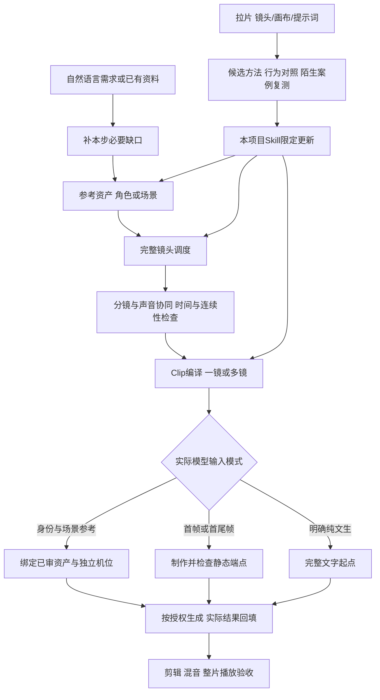

# AIGC_Lab · AI 影像创作实验室

先把想拍的东西设计清楚，再交给AI生成：**参考图资产 → 完整镜头调度 → Clip提示词 → AI视频生成 → 剪辑与混音**。你用自然语言说需求，后台负责参考绑定、空间关系、演员动作、台词声音、镜头节奏和平台适配。

**创作原则：必须控制的内容，要在提示词或明确绑定的参考资产中表达；未明确的内容不能期待模型按创作意图补齐；细节应完整、相关且无冲突。** 模型可能补出未说明的元素，图片也会影响画面，因此质量取决于清楚且一致的完整输入，不是单纯增加字数。

1. **视觉资产**：制作角色/物体与场景参考。角色四格板负责身份锚定，本场服装在每条Clip中独立定义；场景图锁定空间与风格。
2. **镜头调度**：把每个镜头看见和听见的内容写全，交代前后景、相机、动作、台词、声音和精确计划节拍。
3. **Clip编译**：将调度打包为一次生成所需的完整提示词。一条Clip可含一镜或多镜；连续长镜也可分段生成，保留源Shot关系。
4. **视频生成**：按实际模型入口绑定参考资产，首帧/首尾帧是按需要启用的支路；检查真实结果，再接后段。
5. **后期整合**：按实际可用入出点剪辑，调整BGM、对白和音效，完成混音与整片播放验收。

独立生成通常不会自动读取项目台账，参考图构图可能影响输出，否定表达也因模型而异。Clip体系通过自足状态、身份/机位分离、正向正文与平台约束适配来应对这些风险，不把它们写成所有模型都相同的缺陷。详细规则见[Clip编译](skills/aigc-creator/references/clip-prompts.md)与[模型适配](skills/aigc-creator/references/model-adaptation.md)。

**常用入口：**[参考图制作](skills/core/aigc-visual-assets/SKILL.md) · [完整镜头调度](skills/core/aigc-blocking/SKILL.md) · [调度转Clip](skills/core/aigc-video-prompts/SKILL.md) · [四格人物设定表转换提示词](02_提示词库/成熟提示词资产/README.md) · [镜头术语复习](03_参考素材与风格/镜头术语库.md) · [视频拉片复刻库](03_参考素材与风格/视频拉片复刻/README.md)。

本套件1.1.0复用原创作节点，并新增拉片与持续迭代入口，共 **1个总控 + 12个共享节点 + 9个类型模块**。本轮范围见[实施记录](spec/plans/2026-10-19-Clip创作系统.md)，实际输出、修订与检查见[1.1.0训练与验收](06_实验与复盘/2026-10-19_Clip系统训练/README.md)。历史1.0套件的31例文字训练和101项测试见[旧版训练记录](06_实验与复盘/2026-10-16_Skill链训练/README.md)，它们不是新版本或媒体效果的证据。用户级安装与项目源文件分开同步。

## 3分钟快速开始

**第一次使用只需要看这一节。** 想走完一部作品接着看[完整使用路线](#从想法到成片的完整使用路线)；已有材料直接看[按起点选入口](#按你手上已有的材料选择入口)；安装与维护人员再看后面的细则。

### 1. 打开完整项目

已有本地仓库：在 Codex 中打开包含 `README.md`、`AGENTS.md`、`skills/`、`04_作品项目/` 的 **AIGC_Lab 根目录**。从 GitHub 初次使用，可下载并解压仓库，或克隆：

```powershell
git clone https://github.com/nanjiang976-ui/AIGC_Lab.git
cd AIGC_Lab
```

不要只复制某一份 `SKILL.md`，它还需要配套的共享规则。在本项目内可以让 Codex 直接读取项目 Skill 源码；**不必先安装全局套件才能开始**。需要在其他项目使用或通过技能菜单选择时，再按[安装与更新](#安装更新与分类分发)同步。项目源码、用户级安装和当前会话加载是三个不同状态，下载仓库不会自动更新后两者。

### 2. 复制这一条开始新作

下面是可直接发送的示例；把故事换成你的想法即可。无需背 Skill 名称、镜头术语或 Clip 格式。

```text
读取这个项目的 README 和 AGENTS，优先使用项目 skills 目录及同版共享规则。
帮我新建一部20秒、9:16、真人实拍风格的剧情短片：
修表师把修好的旧怀表交给顾客，顾客接过后听见滴答，眼眶渐湿。
先检查已有信息，缺关键创作决定时每次只问一个问题。
本轮只准备文字和提示词，不调用图片或视频生成；平台暂未确定。
按参考资产→完整镜头调度→Clip提示词推进，首帧按实际入口判断。
请保存为新作品，自动维护编号、版本、素材依赖和下轮起点。
```

**你只需补创作决定，不用手填 CSV、JSON、Clip编号或时间映射。** Codex 会识别本轮范围，复用已有资料，自动安排内部节点。20秒是成片设计目标，不代表任意模型都能一次生成20秒。

### 3. 看结果，并给下一步指令

每次先看答复中的“已完成什么、文件在哪、还缺什么”。新作品在[作品项目](04_作品项目/README.md)中单独建目录；只要复制模型正文时看该作品的 `04_生成提示词/本次发送.md`，素材文件、上传绑定和参数看配套交接说明。

**需要真实参考图但尚无图时，Clip仍是草案。** 先使用参考图提示词取得图片，再回传实际文件；检查通过且平台适配完成后，Codex 才整理对应的可发送版。不要把候选稿、整份 README 或内部管理台账直接粘给生成模型。

## 按你手上已有的材料选择入口

| 你现在有什么／想做什么 | 直接这样说 | 会得到什么 |
|---|---|---|
| 只有一个想法 | “帮我完善这个短片想法，每次只问一个关键问题。” | 需求、故事与下一节点；由总控选择合适类型 |
| 已有完整PRD或脚本 | “读取这些资料，直接从完整镜头调度继续，不重新访谈全片。” | 镜头数、空间、表演、对白、声音和时间设计 |
| 要新建人物或物体 | “角色参考图：……，做一套新角色四宫格。” | 正面／侧面／背面／细节的完整提示词 |
| 有不合格人物参考图 | “把这张人物图转成标准四格设定表，保持身份和原衣装。” | 正脸／侧脸／全身正面／全身背面的转换词和素材检查 |
| 要固定场景 | “场景参考图：……，总览和反打保持同一个空间。” | 地标、方向、布局与所需视角提示词 |
| 已有调度 | “把调度转成Clip，给可复制正文、素材绑定和未满足的依赖。” | 一镜／多镜Clip、时间映射和平台适配稿 |
| 只要首帧 | “为这一镜提取动作开始前的静态首帧。” | 单一瞬间的图片提示词，不混入后续整段动作 |
| 已有生成视频 | “检查这段实际结果，指出哪处需要修，先给最小改法。” | 可见问题、证据、修订与受影响后段 |
| 已有全部素材 | “按目标时长整理剪辑、转场、对白、音效和BGM。” | 基于实际素材的剪辑与混音方案 |
| 想学优秀作品 | “拆解这个公开工程或视频，从镜头、画布和提示词提炼一个可用方法。” | 有来源的拉片案例和迁移候选 |
| 想积累经验 | “复盘这次结果，把有证据的方法用于下一部。” | 有适用条件的经验；符合验证门槛才维护项目Skill |

只做一个节点就直接点明，不强迫走完整链路。术语不会用也可以描述想看到的效果；后台负责翻译为具体画面语言。若自动选择不准确，在项目内明确说“读取本项目的 `aigc-blocking`”即可；已安装时也可用 `$aigc-blocking` 指定入口。

## 从想法到成片的完整使用路线

| 阶段 | 你提供或决定什么 | Codex完成什么 | 怎样进入下一步 |
|---|---|---|---|
| 1. 明确作品 | 用途、故事、时长、画幅、风格及已有资料；不确定的可以讨论 | 选择类型，整理需求和已确认设定，建立作品版本 | 核心方向清楚即继续，不重复整部作品访谈 |
| 2. 制作参考资产 | 角色／物体／场景描述，或原始参考图 | 生成参考图正文，标明身份、衣装、空间用途；人物用对应四格预设 | 实际出图后回传文件，检查身份与空间；已有合格资产直接复用 |
| 3. 写完整调度 | 已定故事、台词与不可改变项 | 逐镜写前后景、焦点、机位、动作、情绪物理表现、声音、精确计划节拍与切点 | 阅读是否符合想拍的戏，有问题只改受影响处 |
| 4. 编译Clip | 调度、实际参考、选择的平台／模型／入口 | 分Clip、映射源Shot，写六区块创作包；按平台生成干净发送版 | 核验真实素材与标签；需要首帧/首尾帧时才补对应输入 |
| 5. 生成与检查 | 明确本轮生成范围与预算上限，使用已连接工具或自行在平台生成 | 按授权先测试代表片段，记录实际输入、结果与偏差；检查后再扩展 | 回传实际结果，确认修复还是接受，并据真实状态接后段 |
| 6. 剪辑与混音 | 可用片段、音轨、成片要求 | 整理入出点、转场、对白、环境声、音效、BGM和输出计划；工具可用且获授权时执行 | 检查整段画面与声音，不能只看首尾截图 |
| 7. 复盘与续作 | 具体反馈、实际结果、哪些内容保持不变 | 对照目标，保留成功与失败，沉淀适用经验并记录下轮起点 | 下次按作品ID继续，或把已验证方法用于新作品 |

**只准备提示词**时可完成整个文字制作包；真实素材尚未满足的生成输入保持草案。**实际生成媒体**时，需要明确工具可用、素材齐备与当前生成授权；每个已授权的普通步骤继续执行，不要求你反复批准同一范围。没有可用工具时会交可手动执行的正文和绑定说明，不宣称已经生成。

“全流程”也不等于每种作品都做所有节点：单图走短流程，真实录屏保留真实UI，混剪先盘点现有素材；已有角色或场景资产优先复用。

### 回传图片或视频后怎样继续

在 Codex 附上实际文件，或给出可访问的文件位置和对应作品／Clip；只给口头反馈时会记录为你的反馈，不冒充已看过媒体。可以直接说：

```text
这是刚才作品实际生成的角色图和场景图，请先检查再绑定。
保持人物身份，剧情服装仍按调度正文定义；图有问题先给局部修复建议。
合格后继续整理下一条Clip的发送正文，本轮先不生成视频。
```

```text
这是这条Clip的实际视频：第3秒右手变形，结尾人物已经站起来。
保持台词、衣装和场景不变，只修需要修改的部分，并检查下一条如何衔接。
先做结果审查和提示词修订，不重新生成整部片。
```

### 中断后继续、局部修改和续作

```text
继续我指定的这个WORK作品。读取当前版本、修改记录、连续性台账和最近实际结果，
从“下轮起点”继续。先告诉我已有成果和仍缺的依赖，不重做已确认的部分。
```

同时附上作品目录或准确ID；不要只说“继续最近那个”。已有角色的新集可说“沿用这部作品的角色身份与场景，另建新集；衣装按本集重新确定”。已准备或已验收内容发生变化时，Codex会保留旧版、升版并复查相关下游。

### 三句范围口令

- **“不保存”**：只在聊天交付，不创建作品或回写库。
- **“不入库”**：作品资料按授权保存，不写公共经验索引、提示词库或模型库。
- **“只做这一步”**：只执行当前节点所需工作，不自动扩成整片制作。

## 查资料和判断是否完成

| 遇到的问题 | 去哪里 |
|---|---|
| 想复习景别、机位、运镜、焦点 | [镜头术语库](03_参考素材与风格/镜头术语库.md) |
| 想选更准确的形容和表演写法 | [画面与表演语言库](skills/aigc-creator/references/lexicon.md) |
| 旧人物图要直接转换 | [成熟四格转换提示词](02_提示词库/成熟提示词资产/人物参考图转四格设定表_v001.md) |
| 想借鉴案例与原始提示词 | [拉片复刻库](03_参考素材与风格/视频拉片复刻/README.md)与[通用提示词模块](02_提示词库/分类模块/00_使用索引.md) |
| 不清楚输出文件在哪 | [作品文件说明](#你会拿到哪些文件) |
| 想确认模型能力或更换平台 | [模型适配](skills/aigc-creator/references/model-adaptation.md)，使用前按实际版本与入口核验 |
| 新Skill没出现、全局版本旧 | [安装与使用说明](05_工具与模型适配/AIGC创作Skill使用说明.md)；同步后必要时重启Codex |

完成状态分开看：**文字检查通过 → 平台输入就绪 → 媒体实际生成 → 完整播放与声音检查**。前一步不代替后一步。项目检查命令见[仓库地图与检查](#仓库地图与检查)，一般让 Codex 运行即可，不要求你手动操作。

## 主流程



这是完整视频的默认路线，实际按用途与已有材料裁剪。前置经验检索与每轮结束/暂停时的反馈贯穿这条路线，具体见下方持续迭代说明；文字交付也要复盘，不必等实际成片：

- 视觉概念可以与脚本并行；角色、服装和道具定稿需要匹配剧情。已有适用参考资产直接继承。
- 调度决定人物怎样站、走、看和接触；分镜决定观众从哪里看、看多久、何时切。两者需要往返校对。
- 声音在脚本阶段介入，避免对白到后期才发现放不进镜头；最终音轨和混音在素材成形后核对。
- 无人物的产品、环境或抽象影像不强制做角色三视图；实际录屏不替换为虚构UI；纯文生视频不强制先出图。
- 每一步都有文字审查。只有实际授权生成并检查媒体后，才能推进生成／成片状态。

**交付范围与制作路线分开。** “只生成提示词”只限制本轮执行生成。完整多镜头创作仍交所需参考资产正文、完整调度、Clip包与输入依赖；首帧按实际入口选择，所有路线都写清静态起点。缺所需真实图时将依赖它的Clip标草案，不改走纯文生、不虚构附件。明确纯文生、只要某节点或已有适用资产时按范围裁剪或复用。

历史套件1.0.1的纠正与实际示例见[《钥匙在谁手里》主流程补齐](06_实验与复盘/2026-10-16_全局Skill加载与剧情路由实测/README.md)。上轮纯文生案例作为历史证据保留，不代表完整参考资产流程已测试。该历史main提交范围与验证见[1.0.1发布核对](06_实验与复盘/2026-10-16_全局Skill加载与剧情路由实测/发布核对_1.0.1.md)。

## 视频类型如何归类

目录按**用途与验收目标**分类。真人／2D／3D／定格、横屏／竖屏、对白／旁白、文生／图生是独立维度，不各复制一套 skill。以下覆盖常见用途，不宣称行业只有九种类型。

| 模块与入口 | 适合内容 | 该模块重点检查 |
|---|---|---|
| [剧情与漫剧](skills/modules/narrative/README.md) · `aigc-narrative` | 多角色短片、微短剧、人物小品、AI 漫剧 | 人物目标、行动因果、张力、表演与跨镜连续性 |
| [商业广告](skills/modules/commercial/README.md) · `aigc-commercial` | 商品广告、品牌片、电商、企业／文旅／活动宣传 | 产品识别、外观、传播重点、宣传主张与证据 |
| [科普讲解](skills/modules/explainer/README.md) · `aigc-explainer` | 知识短片、机制说明、课程、数据解释 | 教学目标、事实、类比边界、图像是否准确 |
| [数字人口播](skills/modules/presenter/README.md) · `aigc-presenter` | 虚构讲师、主持、面对镜头解说、人物介绍 | 可讲述性、声音节奏、手势、身份与口型 |
| [纪实与重建](skills/modules/documentary/README.md) · `aigc-documentary` | 纪实、人物采访、历史说明、情景重建 | 事实与来源、真实素材和生成重建的明确区分 |
| [音乐视觉](skills/modules/music/README.md) · `aigc-music` | MV、歌词视觉、节拍动画、音乐叙事 | 音轨结构、拍数与时长、节奏和视听关系 |
| [产品演示](skills/modules/product-demo/README.md) · `aigc-product-demo` | 软件录屏、功能演示、使用步骤、操作教学 | 真实UI／功能证据、步骤、等待与可见结果 |
| [氛围艺术](skills/modules/visual-art/README.md) · `aigc-visual-art` | 环境短片、抽象视觉、循环、背景板、展陈 | 视觉主变量、运动规律、首尾接点与显示条件 |
| [混剪与预告](skills/modules/montage/README.md) · `aigc-montage` | 已有素材混剪、活动回顾、预告、再编排 | 素材清单、入出点、信息顺序、声音与素材缺口 |

**其他类型不一定要新建整套 skill。** 例如“竖屏3D咖啡广告”采用商业模块，加竖屏和3D表现约束；“带剧情的商品广告”以商业为主、剧情为辅。只有出现新的专属输入、创作判断或验收方法时，才新增模块或专用节点。

## 十二个共享创作节点

| 节点 | 输入重点 → 实际交付 |
|---|---|
| [aigc-prd](skills/core/aigc-prd/SKILL.md) | 简要需求／已有PRD → 创作需求书、确认/假设/待定、交付标准 |
| [aigc-script](skills/core/aigc-script/SKILL.md) | PRD与基本设定 → 分场脚本、行动/信息节拍、对白、镜头数量建议 |
| [aigc-visual-assets](skills/core/aigc-visual-assets/SKILL.md) | 角色/场景类型与描述 → 新建/转换四格预设、身份/衣装用途、场景空间视图及图片正文 |
| [aigc-blocking](skills/core/aigc-blocking/SKILL.md) | 脚本与空间设定 → 六维完整逐镜调度，内部协同分镜与声音 |
| [aigc-storyboard](skills/core/aigc-storyboard/SKILL.md) | 脚本与调度 → 具体镜头数、景别、运镜、画面、时长、张力与切点 |
| [aigc-keyframes](skills/core/aigc-keyframes/SKILL.md) | 镜头与已选资产 → 确定瞬间的首帧／必要尾帧／关键姿态图片正文 |
| [aigc-video-prompts](skills/core/aigc-video-prompts/SKILL.md) | 完整调度、真实输入 → 一镜/多镜Clip包、Shot区间映射与平台发送正文 |
| [aigc-audio](skills/core/aigc-audio/SKILL.md) | 对白、人物表演、事件节拍 → 配音稿/指导、环境声、音效、音乐与声音衔接 |
| [aigc-editing](skills/core/aigc-editing/SKILL.md) | 镜头计划／真实素材和音轨 → 入出点、保留时长、转场、字幕、混音与输出计划 |
| [aigc-review](skills/core/aigc-review/SKILL.md) | 当前资料／真实结果 → 有证据的问题、修复提示词、责任节点与复查范围 |
| [aigc-shot-study](skills/core/aigc-shot-study/SKILL.md) | 视频/工程/提示词 → 三层拆解、来源案例、候选方法和复刻证据 |
| [aigc-iteration](skills/core/aigc-iteration/SKILL.md) | 当前需求与实际结果 → 检索、对照、复测、按授权写回与停止条件 |

角色四宫格有两种明确预设：新建角色用正面、侧面、背面、局部细节；旧图转换用正脸、侧脸、全身正面、全身背面。均采用柔光、中性表情、干净纯色背景和9:16/4K目标；场景与物体按适用结构处理。四格板不是视频第一帧；衣装在Clip内独立定义，详见[参考图规则](skills/aigc-creator/references/reference-assets.md)。

## Skill 怎样衔接

六条共同规则已写入 [项目 AGENTS](AGENTS.md)，详细交接见 [共同协议](skills/aigc-creator/references/handoff.md)。总控的实际选择逻辑见 [路由规则](skills/aigc-creator/references/routes.md)。

1. 每个节点说明输入、输出、完成标准和缺项处理，只补本步必要缺口。
2. 共用角色、服装、场景、道具、镜头的固定 ID，以及同一份已确认设定。
3. 同时交付可检查的创作结果和干净的发送正文；编号、版本、上传说明留在正文外。
4. 上游改变时按依赖复查下游，保留历史，不自动重做整片。
5. 计划与生成实际分开；后段根据经检查的真实状态衔接。
6. 统一创作内容，按实际平台、模型版本、入口和输入能力适配。

**交接示例：** 脚本确定“解释失败后落泪”；调度明确B站在桌右、看向左侧A；分镜选择眼平近景缓慢推进；首帧保留尚未落泪的起点；视频正文写吸气、短句、抿唇、目光与落泪；声音节点安排语气和停顿；下镜继承泪痕与站姿。若生成结果中B已经坐下，先决定修正还是接受，再更新受影响的后段。

交接摘要记录：作品/版本、主模块、阶段、输入来源、确认/假设/待定、资产、镜头及三要素、起止状态、下游依赖、检查与下一步。已有字段引用原文件，不另造重复事实表。

## 你会拿到哪些文件

| 内容 | 位置 |
|---|---|
| 用户需求、PRD、确认/待定、下轮起点 | 作品 `00_创作需求.md` |
| 人物、衣装、场景、道具规范 | `01_故事与角色设定.md` |
| 剧情／信息脚本、对白与节拍 | `02_剧情脚本.md` |
| 逐镜资料与图片／视频正文 | `03_分镜表.csv` |
| Clip与Shot映射（新流程） | `04_生成提示词/clips.json`；[兼容契约](spec/clip-contract.md) |
| 纯净可复制正文 | `04_生成提示词/本次发送.md`；候选另放草案 |
| 实际生成输入、参数、媒体 | `05_生成结果/` |
| 修改与范围明确的审查证据 | `06_修改与验收.md` |
| 母版／计划／实际状态 | `07_连续性台账.md` |
| 片段、剪辑时长与衔接 | `08_分段与衔接.md` |

调度、声音、张力和剪辑细节按需要放在相应 Markdown 专节或补充文件；保留现有分镜 CSV 表头和历史作品。训练用例与执行输出放复盘目录，不登记成已完成真实作品。

## 提示词与专业资料

- [用户三截图原件与拆解](skills/aigc-creator/references/screenshot-analysis.md)：镜头条目、调度混合稿、首帧＋连续动作的分工。
- [导演语言方法](skills/aigc-creator/references/prompt-language.md)：一句话怎样变成具体镜头、张力、动作与表演。
- [镜头术语定义与易混项](skills/aigc-creator/references/shot-glossary.md)：独立复习，景别名称配具体裁切。
- [视频拉片与复刻](03_参考素材与风格/视频拉片复刻/README.md)：可检索案例、原始提示词索引及真实证据。
- [56条画面/表演语言](skills/aigc-creator/references/lexicon.md)：词语的可见作用、适用条件和冲突，初始条目未做媒体实测。
- [真实电影案例](skills/aigc-creator/references/film-cases.md)：6个有来源的案例，区分资料证实与方法迁移。
- [模型适配记录](skills/aigc-creator/references/model-adaptation.md)：Seedance与Runway的具体版本/输入规则，核验日期与未验证范围。
- [原有12类、60条提示词模块](02_提示词库/分类模块/00_使用索引.md)：按需检索、查重与复用；模块状态以各记录为准。

重要主体、动作与硬约束前置，这是已获用户确认的编排原则，不是所有模型的位置权重定律。修饰词要服务可见结果；复杂场面要有角色目标、空间、触发和接触关系。镜头的三要素始终是**相机、角色/主体、画面**，并补齐前后衔接。

## 安装、更新与分类分发

源目录按用途归类，安装目录按唯一 skill 名平铺。总控保存共享资源，其他21个skill通过依赖关系使用它；安装一个叶节点时不能漏掉总控。完整清单见 [skills/catalog.json](skills/catalog.json)。

```text
skills/
├─ aigc-creator/          总控、共享协议、原截图、语言库、来源资料
├─ core/aigc-*/          12个共享节点
├─ modules/
│  ├─ narrative/         剧情模块及其专属skill
│  ├─ commercial/        广告模块及其专属skill
│  └─ ...                另外7个用途模块
└─ catalog.json          唯一名称、路径、分类与安装依赖
```

在项目根目录运行，Python 3.10+，仅用标准库：

```powershell
# 检查整套源码、名称、依赖及包内链接
python -X utf8 scripts/skill_bundle.py validate

# 默认只显示计划，不写入安装目录
python -X utf8 scripts/skill_bundle.py install --target "$env:USERPROFILE\.codex\skills"

# 确认计划后首次安装
python -X utf8 scripts/skill_bundle.py install --target "$env:USERPROFILE\.codex\skills" --apply

# 更新已有版本：先在目标目录外备份将覆盖的文件
python -X utf8 scripts/skill_bundle.py install --target "$env:USERPROFILE\.codex\skills" --apply --update
```

同名内容不同而未指定更新时，整批不写。未知额外文件保留并报告；源与安装副本不会自动双向同步。更新前先检查输出中的差异和备份位置。安装后核对技能列表；尚未刷新时重启。完整说明见 [安装与使用](05_工具与模型适配/AIGC创作Skill使用说明.md)。

在已明确的完整项目中，各skill优先读该项目的配套资料；脱离项目再读配套安装包。这样不会把新工作树的节点与旧全局总控混接。源文件存在、安装复制成功、当前会话自动触发是三个不同的验证层次。

## 持续迭代：让下一次创作使用上一次的经验

**操作入口：[持续迭代使用指南](06_实验与复盘/持续迭代使用指南.md)**。包含开始创作、反馈一稿、复盘回写和下一轮复用的可复制口令。

本项目每轮先从目标、事实和约束推导问题与改法，再执行“检索经验 → 本轮使用 → 对照复盘 → 按证据更新 → 下轮再用”。Codex 执行创作任务时按项目规则完成这些步骤；拉片与复盘可自动积累候选，经过真实行为对照和陌生案例复测才更新本项目自定义Skill，核心原则改变仍先确认。没有任务运行时不会在后台自行学习。积累的是文件中的经验与方法，不是重新训练模型。

[经验索引](06_实验与复盘/经验索引.md)是统一入口，完整状态和执行规则见[持续迭代规则](spec/持续迭代.md)。索引建立时为零条，已有作品的记录不会被自动标为有效经验；后续按实际反馈和证据登记，允许零新增。

现在已有一个真实的文字创作闭环：[《先做一小步》v001→v002](06_实验与复盘/2026-10-16_WORK-003_持续迭代闭环.md)。第一轮从空索引开始，独立复盘后登记 EXP-001 候选，第二轮先检索再实际采用，最后只把有证据的文字交接范围升级；没有生成媒体或验证观众效果。以后怎样开始、反馈、复盘和复用，见[持续迭代使用指南](06_实验与复盘/持续迭代使用指南.md)。

### 从第一性原理推导每一次改动

先从**想改变的结果、已知事实和真实约束**推导下一步，再判断经验和模板是否适用。经验提供候选做法，不能代替当前任务的判断；已确认的创作原则如需改变，先说明取舍并询问用户。

| 步骤 | 先回答什么 | 留下什么 |
|---|---|---|
| 1. 定义结果 | 给谁看，希望观众理解、感受或做什么？本轮怎样判断达到目标？ | 一个具体改进目标，以及不能改变的内容 |
| 2. 还原事实与约束 | 哪些已观察到？哪些只是解释或假设？时长、素材、授权、预算有哪些限制？ | 事实、假设、未知项分开；用户已确认与 Agent 工作假设分开 |
| 3. 找最小瓶颈 | 哪个尚未解决的条件最妨碍目标？它属于需求、剧情、调度、提示词还是后期？ | 指向具体镜头/文件的证据与最小修订范围；没有缺陷也可保留原稿 |
| 4. 先写可检查的假设 | 在条件C下，把A改成B，预期会出现什么变化？哪些结果会否定这个判断？ | 修改前原稿、预定判据、不变项和适用条件；检索经验并核对条件 |
| 5. 做最小一轮并对照 | 实际改了什么？结果有帮助、无变化、变差还是尚未执行？ | 实际改变创作内容才按规则升版，并独立复核；多处同时变化时分开记录，不把全部效果归因于一条经验 |
| 6. 按证据沉淀和停止 | 证据究竟支持到哪里？下一任务能否复用？当前是否已达标，或必须等待真实媒体/反馈？ | 先保存结果再更新经验；注明范围、反例和下轮起点；无新证据允许零新增 |

这六步已接入本项目 [AGENTS.md](AGENTS.md) 和[创作前后执行细则](spec/持续迭代.md)，后续每轮默认执行，不必重复下口令。Codex 在作品 `06_修改与验收.md` 留一组前后记录，按[持续迭代验收](spec/acceptance.md#持续迭代流程验收)核对。新作没有旧稿时按预定需求检查首稿，未发现问题可保留原稿；不为跑流程制造失败、强行升版或新增经验。停止时注明达标或待补条件，未执行的媒体/观众效果继续保持未知。

《先做一小步》中，“看完知道怎么做”是用户新增目标，不能倒推原稿失败。独立审查另发现编辑镜头缺光标前提，于是提出并实际试用“起始文本、光标/选区、操作、目标文本”四项交接；字符推演通过只支持本例的文字操作确定性。观众是否学会、真实软件是否如此响应、媒体是否合格，分别需要对应证据。

日常可以直接说：

```text
这轮要改善【结果】，保留【不可改变的约束】。
请先区分事实、假设和未知，定位最小瓶颈，核对相关经验。
修改前写清判据并保存原稿，只改受影响部分；完成后对照结果和反例。
只把证据支持的方法与条件写回经验，留下下轮起点。
本轮只准备文字和提示词，不调用媒体生成。
```

| 时机 | 执行过程 | 保存位置 |
|---|---|---|
| 开始创作或续作 | 明确目标、事实/假设/未知、约束和瓶颈，提出假设后按条件查经验 | 作品本轮记录目标与依据、改法、经验 ID + 版本或无匹配、原稿位置及改前判据 |
| 制作与修改 | 只采用适用的方法；保留用户反馈、实际输入输出与对应镜头，分开事实和原因假设 | 作品资料、生成记录和修改记录 |
| 本轮结束或暂停 | 对照原稿和预定判据，记录效果、反例、归因限制、停止理由和下轮条件 | 作品 06_修改与验收.md；必要时用[实验记录模板](06_实验与复盘/实验记录模板.md) |
| 有新结论或反例 | 查重，先写来源和证据；更新实际变化的模块/模板/模型条件，最后更新经验索引 | 提示词表达进提示词库，模型条件进适配目录，详细试验留复盘；纯复用不写公共流水账 |
| 下一轮 | 重新核对状态和条件，优先使用适用的已验证经验，对候选或待复验项有标注地试用 | 保留本轮效果记录，继续收窄或扩展有证据支持的范围 |

经验有四种状态：**候选、已在指定范围验证、待复验、停用**。每次验证写清范围、执行者、日期、样本与证据；模型或条件变化、出现反例时重新审查，旧版和失败记录保留。文本检查通过只能支持文本/流程结论，关联提示词没有实际媒体结果时仍是“未实测”，也不会自动把作品改成已生成或已验收。

例如，实际生成中发现动作未完成，可以提出“减少一个镜头中的动作数量”作为候选改法；在已有授权范围内进行比较，保存输入与输出，再按真实结果决定保留、调整或停用。这个例子只是方法说明，不是本项目已经验证的经验。

你可以照常描述创作需求，也可以直接说：

```text
开始前查一下经验索引，只采用适合本次作品的经验。
本轮结束后记录哪些有帮助、哪些还没验证，并留下下轮改进点。
```

在外部平台生成后，可以提供实际结果和具体反馈，供本项目记录与审查。仅有口头反馈会标明来源，不会冒充 Agent 已播放或目视检查。“不保存”时只在聊天复盘；“不入库”时只按授权保留作品内部记录。审美偏好默认只对本作品生效，明确要求以后沿用才登记为项目偏好。

本流程由本项目 [AGENTS.md](AGENTS.md)接入，沿用现有 Skill 的项目读取流程。旧作品不批量补填或重写，后续创作按最新规则记录。初始机制见[持续迭代落地计划](spec/plans/2026-10-16-持续迭代流程.md)，第一性原理接入与冲突检查见[本轮执行计划](spec/plans/2026-10-18-第一性原理迭代流程接入.md)。


## 每个 Skill 后续怎样打磨

日常创作和拉片先把来源、实际结果与候选方法记录到作品／实验。按2026-10-19已确认的范围，经过真实行为对照、独立实际执行和陌生案例复测后，可以更新本项目自定义 `skills/` 源码；核心创作原则改变仍先问用户。全局安装、第三方／系统Skill、长期记忆和发布不会随入库自动改变。详见[持续迭代规则](spec/持续迭代.md)。

固定采用：**保存真实请求与原始答复 → 找到具体缺口 → 修改最少规则/例子 → 独立执行 → 陌生题材复测 → 有媒体时补实际试拍**。记录输入、版本、实际输出、问题位置、修改原因和证据；不为证明新版本更好而捏造旧版失败。

| 节点 | 正常案例重点 | 边界/变化案例重点 |
|---|---|---|
| 总控 | 选对类型、从已有阶段继续 | 单图、不保存、混合用途、旧安装与新工作区 |
| PRD | 每轮一问且需求逐渐明确 | 完整PRD不重问、冲突只问关键项 |
| 脚本 | 行动因果、信息揭示、具体镜头数量理由 | 不擅改用户结局、对白与时长冲突 |
| 视觉资产 | 新建/转换四格预设、同一身份与场景方向一致 | 不对称配件、缺图不出空白格、物体与场景不套人脸规则 |
| 调度 | 站位/朝向/视线、交接动作可达 | 绕拍后左右变化、真实终帧与计划不同 |
| 分镜 | 三要素、张力与切点、总时长 | 动作过载、景别看不清关键动作 |
| 关键帧 | 仅一个时刻、构图与输入状态清楚 | 首帧混入连续动作、参考图尚不存在 |
| Clip提示词 | 动作因果、自足正文、Shot区间与真实绑定 | 多镜一Clip、长镜分Clip、缺首帧、平台格式差异 |
| 声音 | 可说的台词、试读、音效触发 | 未试听、超长口播、声音身份或口型未知 |
| 剪辑 | 源入出点、保留时长、转场与声音 | 画面重叠重复扣减、素材缺失、纪实顺序 |
| 审查 | 具体问题→责任节点→修复与复查 | 无媒体不报视觉通过、不替用户认可审美 |
| 拉片/迭代 | 三层拆解、来源和候选、真实行为对照 | 只有截图不造工程；用户偏好与实测结论分开 |

各类型模块的专用训练重点就在上方分类表最后一列；每个模块的 SKILL.md 还含正常题和边界题。剧情测试角色因果；广告测试无证据主张；科普测试类比失真；口播测试时长；纪实测试来源身份；音乐测试拍数/音轨；产品演示测试真实UI；氛围测试循环接点；混剪测试素材与事件顺序。

每轮复盘只提炼有跨作品复用价值的方法，按证据登记为候选或对应状态；具体角色与事实留在作品里。语言库新增要有适用/失败条件与验证状态，允许零新增。第三方和系统skill不自动改写，长期记忆不自动更新。

## 仓库地图与检查

| 位置 | 用途 |
|---|---|
| [AGENTS.md](AGENTS.md) | 用户核心创作逻辑、六条交接规则与项目边界 |
| [spec](spec/harness-engineering.md) / [计划](spec/plans/README.md) | 作品契约、决策、实施与验收 |
| [创作模板](01_创作模板/README.md) | 创建作品用，不能当真实成品 |
| [提示词库](02_提示词库/README.md) | 可复用模块与验证状态 |
| [参考素材](03_参考素材与风格/README.md) | 素材用途、来源与限制 |
| [作品项目](04_作品项目/README.md) | 一作品一目录，保留版本与结果 |
| [工具适配](05_工具与模型适配/README.md) | 模型与入口、日期、证据 |
| [实验复盘](06_实验与复盘/README.md) | 实际测试、失败、修订和经验 |
| [Skill索引](skills/README.md) | 套件路径、分发清单与共享资源 |
| [校验脚本](scripts/validate_project.py) | 只读检查，不调用生成平台 |

```powershell
python -X utf8 scripts/validate_project.py
python -X utf8 scripts/skill_bundle.py validate
python -X utf8 -m unittest discover -s scripts/tests -v
# 对实际作品按范围另运行 --work 与 --phase prompts/delivery
```

每个 skill 还要运行系统 `skill-creator/scripts/quick_validate.py`，并执行有意义的行为题。检查通过只覆盖其实际范围；见 [验收标准](spec/acceptance.md)。

Git保存文字和小型参考图，大媒体独立备份。发布只包含当前任务明确范围，其他作品与未提交资料保留本地；项目源码推送不等于用户级Skill已安装。历史发布依据保留在各计划／复盘中；1.1.0的系统证据见[训练与验收](06_实验与复盘/2026-10-19_Clip系统训练/README.md)，本次使用指南与发布范围见[发布记录](spec/plans/2026-10-19-Clip系统发布.md)。
