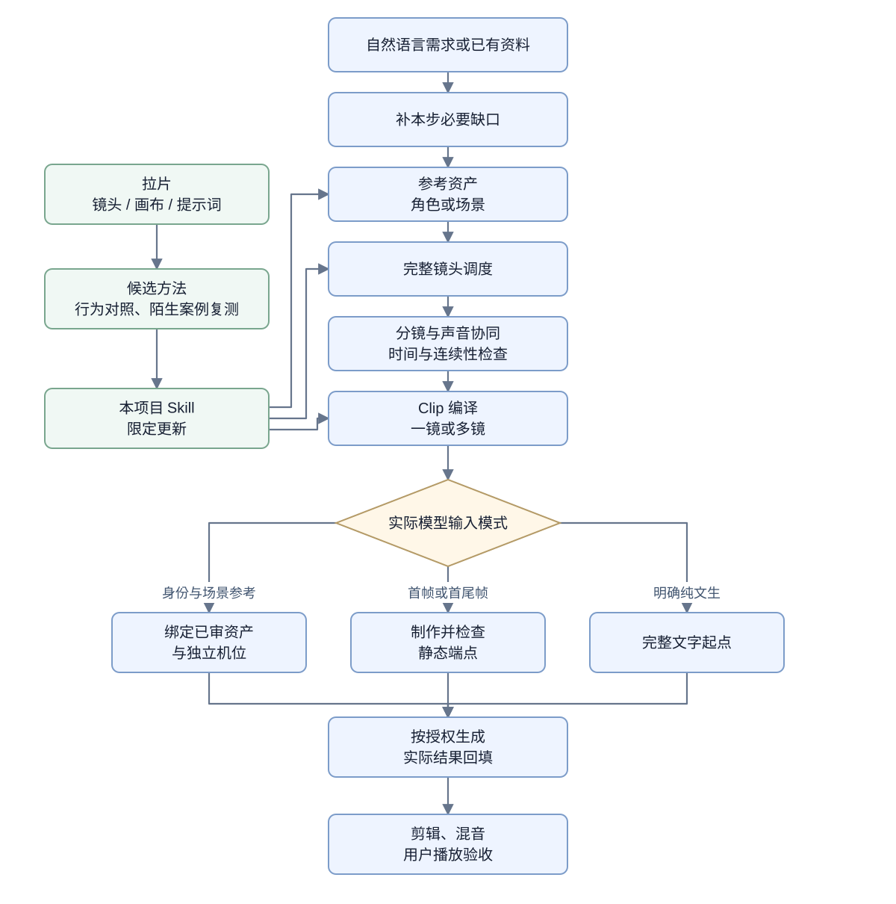

# AIGC_Lab · AI 影像创作实验室

> [!IMPORTANT]
> ### 先把想拍的东西设计清楚，再交给 AI 生成
>
> **想法与需求 → 剧本 → 视觉资产与人物音色 → 完整调度及逐 Shot 声音／BGM → Clip 提示词**
>
> **每一步先给你当前结果，你可以修改，再调用下一节点。你在 LibTV 生成图片、人物声音、BGM和每段 Clip；Codex 负责把最新剧情、整体风格、提示词与节点连接说明传到下一步。**

**每次开工：**[复制通用开工模板](skills/aigc-creator/references/usage.md#可复制调用模板) → 填写作品用途、已有材料和本轮步骤 → [按作品类型逐步制作](#按作品类型逐步制作)。第一次做剧情漫剧可直接看[完整八步](#剧情短片与ai漫剧)；其他八类各有自己的顺序，不必套用剧情流程。

**随手记录：**[我的 AIGC 笔记](我的AIGC笔记.md)——想法、学习心得和待试方法都可以直接记；推送后在 GitHub 点编辑铅笔保存。

**创作原则：必须控制的内容，要在提示词或明确绑定的参考资产中表达；未明确的内容不能期待模型按创作意图补齐；细节应完整、相关且无冲突。** 模型可能补出未说明的元素，图片也会影响画面，因此质量取决于清楚且一致的完整输入，不是单纯增加字数。

下面五步概览以剧情短片和漫剧为例；其他用途直接使用[各自制作顺序](#按作品类型逐步制作)。

1. **需求与剧本**：把想法变成可修改的需求，再写剧情、动作与台词，列出人物、重要道具和场景清单。
2. **视觉与声音资产**：人物、重要道具、场景逐项给图片正文；需要固定声音的角色再给音色设计、语言/方言与试听文本。人物图锚身份，道具单张锁结构，场景图锁空间；每条Clip独立定义衣装。你在LibTV生成并选定图片和角色声音。
3. **完整镜头调度与BGM**：写清每镜的相机、行动、画面、台词声音、计划节拍与切点；每个需要配乐的Shot给完整BGM提示词，说明新起/延续/变化/收束。连续镜头可以共用同一段音乐。
4. **Clip提示词与连接说明**：将你确认的调度编成一镜或多镜Clip。每段后面列出应该多选的具体图片或片段、各自作用和要生成的视频节点。
5. **生成与后期**：你在LibTV逐段生成、观看并反馈；Codex根据实际状态修词或接后段，最后整理剪辑与混音文字方案。

独立生成通常不会自动读取项目台账，参考图构图可能影响输出，否定表达也因模型而异。Clip体系通过自足状态、身份/机位分离、正向正文与平台约束适配来应对这些风险，不把它们写成所有模型都相同的缺陷。详细规则见[Clip编译](skills/aigc-creator/references/clip-prompts.md)与[模型适配](skills/aigc-creator/references/model-adaptation.md)。

**常用入口：**[aigc-visual-assets（参考图资产）](skills/core/aigc-visual-assets/SKILL.md) · [aigc-blocking（场面调度）](skills/core/aigc-blocking/SKILL.md) · [aigc-video-prompts（视频提示词）](skills/core/aigc-video-prompts/SKILL.md) · [四格人物设定表转换提示词](02_提示词库/成熟提示词资产/README.md) · [镜头术语复习](03_参考素材与风格/镜头术语库.md) · [视频拉片复刻库](03_参考素材与风格/视频拉片复刻/README.md)。

当前套件为1.4.1，共 **1个总控 + 11个共享节点 + 9个类型模块**；每个Skill均有个人调用模板和使用方法。本版更新通用开工模板，并补齐九类作品的制作顺序与节点衔接说明，见[本轮实施与验证](spec/plans/2026-10-20-通用开工模板与分类制作流程.md)。拉片提案审批、素材全名加粗、中文名称及可点击导航沿用[1.4.0](spec/plans/2026-10-20-拉片审批与节点导航.md)；人物四格、单张道具、角色音色、BGM和当前作品脉络沿用[1.3.0](spec/plans/2026-10-20-素材声音与全片脉络发布.md)；1.2.0移除独立审查节点的依据见[历史记录](skills/aigc-creator/references/review-removal-validation.md)。历史训练与本轮证据分开，不以旧测试或文字执行代替媒体效果。用户级安装与项目源文件分开同步。

**跨节点怎样保持一致：**每次进入新节点，Codex先核对最新剧本、全片/场景风格、已选图像/声音、前后镜头状态及你刚做的修改，再生成本步正文。你不用重复填表；本聊天直接复用，跨聊天可带走当前交接卡。详见[当前作品脉络](skills/aigc-creator/references/current-context.md)与[人物音色和BGM](skills/aigc-creator/references/voice-and-music.md)。

## 用户在LibTV完成媒体验收

实际图片、视频、声音和成片由用户在LibTV观看、试听并选择；用户反馈“已选用”或具体偏差后，Codex直接继续对应的调度、Clip、声音或剪辑修改，不设置独立审查节点，不要求先上传媒体供Codex复审。Codex仍负责提示词、台词、时间与引用的文字自检；用户反馈、真实标签和未知项分别记录，不虚构素材或验收通过。

## 我的 Skill 调用模板

**新作品统一从 [aigc-creator（全链路创作总控）](skills/aigc-creator/references/usage.md) 开始即可。** 在[通用开工模板](skills/aigc-creator/references/usage.md#可复制调用模板)中写清用途、已有材料与“本轮先做到哪里”，总控据此说明主类型、当前节点和本轮交付。它会沿用当前资料连接必要的后续节点；不会因为你选了类型，就一次执行整条链。已有明确节点时也可以直接调用它，不必重新开工。

| 你要说明的层次 | 作用 | 例子 |
|---|---|---|
| 作品用途 | 选择主类型及其创作判断 | AI剧情与漫剧、商业广告、科普解释 |
| 表现形式与规格 | 约束画面和声音的表达 | 2D／3D／真人写实、9:16、30秒、普通话 |
| 当前节点与已有材料 | 决定这次具体做什么、从哪里继续 | 只有一句想法先整理需求；已有剧本直接写完整调度 |

**通用节点决定这一步做什么，类型模块决定这类作品重点检查什么。** 真人／2D／3D、横竖屏和文生／图生不另复制一套 Skill。catalog 的依赖表示配套可用，不表示每个作品都要顺序走完21项。完整开工模板只维护在总控用法页，下面保留简短口令与各节点入口。

下面的例句发给 Codex；打开对应“模板与用法”可复制完整模板。模板第一行的 `$skill-name` 明确指定入口，后台沿用当前项目同版本源码。真正交给图片、视频或剪辑平台的正文由节点展开，上传和参数另列。

### 通用能力：总控与共享节点

| 现在要做什么 | 模板与用法 | 可以直接这样说 |
|---|---|---|
| 总控选路 | [aigc-creator（全链路创作总控）](skills/aigc-creator/references/usage.md) | 我想做一部30秒短片，已有角色但没有故事，请判断从哪步开始；只做文字。 |
| 完善需求 | [aigc-prd（创作需求）](skills/core/aigc-prd/references/usage.md) | 把“雨夜归还一把伞”完善成可制作的需求，每次只问一个关键问题。 |
| 写故事与信息脚本 | [aigc-script（剧情脚本）](skills/core/aigc-script/references/usage.md) | 把两位朋友归还雨伞后和解的故事写成20秒脚本，结尾保持克制。 |
| 做参考资产 | [aigc-visual-assets（参考图资产）](skills/core/aigc-visual-assets/references/usage.md) | 新建短发女性的四格角色参考图提示词，灰色外套，人物右脸有一颗痣。 |
| 写完整镜头调度 | [aigc-blocking（场面调度）](skills/core/aigc-blocking/references/usage.md) | 把上述归伞脚本写成完整调度，一起设计相机、动作、画面、声音和节拍。 |
| 单独改分镜 | [aigc-storyboard（分镜设计）](skills/core/aigc-storyboard/references/usage.md) | 保留剧情与台词，只比较3镜和5镜的景别、信息递进与切点。 |
| 制作静态首帧／关键帧 | [aigc-keyframes（静态关键帧）](skills/core/aigc-keyframes/references/usage.md) | 为递伞之前写静态首帧提示词，双手尚未接触，不写后续动作。 |
| 编译Clip | [aigc-video-prompts（视频提示词）](skills/core/aigc-video-prompts/references/usage.md) | 把上述调度转成LibTV Clip提示词，列素材绑定与缺项；仅聊天、不生成。 |
| 人物音色／逐Shot BGM／对白 | [aigc-audio（声音制作）](skills/core/aigc-audio/references/usage.md) | 给人物音色设计与试听文本，再为需要配乐的Shot写完整BGM提示词；保持当前作品风格，仅交文字。 |
| 剪辑与后期 | [aigc-editing（剪辑时间轴）](skills/core/aigc-editing/references/usage.md) | 根据这三段实际视频写文字智能剪辑指令，保留声音跨切并核算总片长。 |
| 拉片与项目对照 | [aigc-shot-study（拉片分析）](skills/core/aigc-shot-study/references/usage.md) | 拉片这个公开画布，对照当前项目，先给优化方案等我批准。 |
| 复盘与持续迭代 | [aigc-iteration（创作复盘）](skills/core/aigc-iteration/references/usage.md) | 对照原目标复盘这轮结果，保留失败与反例，只沉淀有依据的经验。 |

**常用的整合入口是“完整镜头调度”。** 它已在后台协同分镜与声音，不要求你把同一场戏再送三个节点。只调整镜头或只修声音时，对应专项入口才单独使用。首帧按真实模型入口启用，身份参考板不直接当视频第一帧。

**平台执行生成与剪辑，用户在LibTV观看试听验收，Skill负责把要求写准并按反馈修改。** 本链先交所需人物音色与BGM资产提示词；原生视频能发声不代替这些交付。实际生成时根据入口区分音色样音、完整对白、BGM和原生音轨，避免重复对白或重复配乐。文字智能剪辑可用时，后期节点直接给该入口的指令；入口能力仍需核验。

### 按作品用途选择：类型模块

类型模块通常选一个主类型；已有明确节点时直接调用该节点，不必先把类型表走一遍。混合用途只在需要时补一个次类型。

| 作品类型 | 模板与用法 | 可以直接这样说 |
|---|---|---|
| 剧情短片／AI漫剧 | [aigc-narrative（剧情与漫剧）](skills/modules/narrative/aigc-narrative/references/usage.md) | 做一部朋友雨夜归伞的写实剧情短片，用行动完成和解。 |
| 商品／品牌广告 | [aigc-commercial（商业广告）](skills/modules/commercial/aigc-commercial/references/usage.md) | 为这款保温杯设计20秒广告，只用我已提供证据的卖点。 |
| 科普／知识解释 | [aigc-explainer（科普解释）](skills/modules/explainer/aigc-explainer/references/usage.md) | 用热量转移解释热泵，明确真实机制与类比的边界。 |
| 数字人／主持口播 | [aigc-presenter（主持人口播）](skills/modules/presenter/aigc-presenter/references/usage.md) | 把这份文字改成45秒数字人口播，安排停顿、手势和可说出的句子。 |
| 纪实／情景重建 | [aigc-documentary（纪实与重建）](skills/modules/documentary/aigc-documentary/references/usage.md) | 根据这些来源做人物纪实短片，区分档案画面与情景重建。 |
| 音乐MV／节拍视觉 | [aigc-music（音乐影像）](skills/modules/music/aigc-music/references/usage.md) | 按这首已提供音乐的段落和拍点设计MV，先写视听方案。 |
| 产品操作／软件教程 | [aigc-product-demo（产品演示）](skills/modules/product-demo/aigc-product-demo/references/usage.md) | 根据这些真实界面和操作步骤做教程，未提供的按钮与结果保留待查。 |
| 氛围艺术／循环影像 | [aigc-visual-art（视觉艺术）](skills/modules/visual-art/aigc-visual-art/references/usage.md) | 做一个10秒雨夜霓虹循环影像，先设计运动规则和首尾接点。 |
| 现有素材混剪／回顾 | [aigc-montage（混剪回顾）](skills/modules/montage/aigc-montage/references/usage.md) | 把这批活动素材整理成30秒回顾，保留事件顺序并标记素材缺口。 |

### 完成一个节点后怎样继续

每个节点交付后**默认停下，供你调整**；末尾用**加粗文字写出下一节点、应沿用的具体成果，以及一句可复制的继续口令**。同一聊天直接引用刚才的成果，只补新增资料；跨聊天再携带点名的正文、版本和素材名称。你在LibTV选定图片后，告诉Codex完整节点名称与实际标签即可；不要求再上传做一次媒体复审。尚无真实素材时，后续文字可以继续设计，涉及实际绑定的部分保持草案。

例如：**下一节点：aigc-video-prompts（视频提示词）。继续说“把上述完整调度转成LibTV Clip，沿用角色和台词，仅聊天”；本聊天直接复用刚才的脚本、逐镜调度和锁定项，实际图未提供的部分保持草案。**

只有你明确要求“本轮连续完成这些节点”时才连续执行指定范围；“帮我做一个视频”默认从当前必要节点开始，不等于一次输出整条链。分镜与声音可以在完整调度节点内部协作，不额外增加你要点的步骤。历史结尾衔接检查见[1.1.2验证](skills/aigc-creator/references/next-step-validation.md)，本轮修订见[逐步交接计划](spec/plans/2026-10-20-逐步提示词交接与Clip候选.md)。

## 按你手上已有的材料选择入口

| 你现在有什么／想做什么 | 直接这样说 | 会得到什么 |
|---|---|---|
| 只有一个想法 | “帮我完善这个短片想法，每次只问一个关键问题。” | 需求、故事与下一节点；由总控选择合适类型 |
| 已有完整PRD或脚本 | “读取这些资料，直接从完整镜头调度继续，不重新访谈全片。” | 镜头数、空间、表演、对白、声音和时间设计 |
| 要新建人物 | “角色参考图：……，按当前四宫格样式做新角色参考图。” | 正面胸像／3/4胸像／背面全身／略3/4正面全身的完整提示词 |
| 要独立道具参考 | “为剧情关键的旧录音机单独写一张参考图提示词，锁定按钮、磁带仓与外壳结构。” | 该道具单张、单视角的完整正文、素材名称和结构锚定用途 |
| 有不合格人物参考图 | “把这张人物图转成当前四格设定表，保持身份和原衣装。” | 同一四格布局的转换词；未知背面和未展示细节另行说明 |
| 要固定场景 | “场景参考图：……，总览和反打保持同一个空间。” | 地标、方向、布局与所需视角提示词 |
| 已有调度 | “把调度转成Clip，给可复制正文、素材绑定和未满足的依赖。” | 一镜／多镜Clip、时间映射和平台适配稿 |
| 只要首帧 | “为这一镜提取动作开始前的静态首帧。” | 单一瞬间的图片提示词，不混入后续整段动作 |
| 已有生成视频 | “我在LibTV看过这段，结尾人物已经站起，右手变形；保持其他内容，只修提示词并接后段。” | 按用户反馈修改的正文及受影响后段；不把未观看媒体说成已检查 |
| 已有全部素材 | “按目标时长整理剪辑、转场、对白、音效和BGM。” | 基于实际素材的剪辑与混音方案 |
| 想学优秀作品 | “拆解这个公开工程或视频，从镜头、画布和提示词提炼一个可用方法。” | 有来源的拉片案例和迁移候选 |
| 想积累经验 | “复盘这次结果，把有证据的方法用于下一部。” | 有适用条件的经验；符合验证门槛才维护项目Skill |

只做一个节点就直接点明，不强迫走完整链路。术语不会用也可以描述想看到的效果；后台负责翻译为具体画面语言。若自动选择不准确，在项目内明确说“读取本项目的 `aigc-blocking`（场面调度）”即可；已安装时也可用 `$aigc-blocking` 指定入口。

## 从想法到成片的完整使用路线

新作先用[总控开工模板](skills/aigc-creator/references/usage.md#可复制调用模板)，接着按下方对应类型的步骤继续。同一作品不必每轮重发模板：同一聊天直接说“按刚才确认的内容继续”；换聊天时提供作品目录或准确ID，让Codex读取最新版本和修改记录。

**只准备提示词**不代表必须一次做完整包，默认按你当前调用的步骤交付。你明确要求连续完成多个文字节点时才按授权范围推进；真实素材尚未满足的生成输入保持草案。本路线由你在LibTV生成媒体；如果另行委托Codex操作平台，再核对工具、素材、范围与费用授权。

**Clip格式已于2026-10-20获用户批准：**每条完整展开六区块与STYLE LOCK八项，按本条局部时间写清动作、声音与终态；正式规则见[Clip编译](skills/aigc-creator/references/clip-prompts.md)，[批准的样稿](spec/reviews/2026-10-20_Clip格式候选_v001.md)保留审核来源。画布连接说明独立放在每条提示词后面。

## 按作品类型逐步制作

以下是九类作品的日常操作顺序。每步先交当前结果、供你修改，再用对应口令继续；已有合适材料直接复用，缺什么只补本步所需。**首帧或尾帧只在实际模型入口需要或明确要控制端点时另做，身份参考图不等于视频第一帧。** 图片提示词不套视频Clip格式；单幅图片做到画面和图片正文即可。实际素材与成片由你在LibTV观看、试听和选择，Codex根据反馈更新文字。

[剧情与漫剧](#剧情短片与ai漫剧) · [商业广告](#商品与品牌广告) · [科普解释](#科普与知识解释) · [主持人口播](#数字人与主持口播) · [纪实与重建](#纪实与情景重建) · [音乐影像](#音乐mv与节拍视觉) · [产品演示](#产品操作与软件教程) · [视觉艺术](#氛围艺术与循环影像) · [混剪回顾](#现有素材混剪与回顾)

### 剧情短片与AI漫剧

主类型：[aigc-narrative（剧情与漫剧）](skills/modules/narrative/aigc-narrative/references/usage.md)。适合以人物目标、冲突、选择和关系变化推动的短片或有时间轴的漫剧。开工时写清“谁想要什么、什么阻止他、他做了什么选择、最后发生什么变化”；只有一句故事想法也可以先开始。

> 请使用本项目源码中的 $aigc-creator。作品用途是AI剧情与漫剧，我想做“两个朋友在雨夜归还一把伞，通过行动和解”的30秒竖屏2D短片。已有材料暂无，本轮先整理需求，先只在聊天交付；每步完成后停下并给下一句口令。

**第1步：进入项目，确定这部作品的需求。** 告诉Codex是新作，还是继续哪部作品。[aigc-creator（全链路创作总控）](skills/aigc-creator/references/usage.md)选择主类型，并按需交给[aigc-prd（创作需求）](skills/core/aigc-prd/references/usage.md)，整理主题、人物关系、故事变化、风格、时长和声音要求。你主要判断故事方向、人物关系和结局是否准确，确认后继续：

> 按刚才确认的需求写剧情脚本，保留人物关系、结局和风格。本轮只交剧本及资产清单，完成后先停。

**第2步：写剧本，把故事和台词调整到满意。** [aigc-script（剧情脚本）](skills/core/aigc-script/references/usage.md)交付剧情、动作、对白、节奏，以及人物、重要道具和场景清单；剧情模块检查人物因果与情绪递进。可以直接修改，例如：

> 中间的误会不要靠解释台词解决，改成周川看见伞柄上的修补痕迹后态度变化。保持结局和总时长，先只修改剧本。

剧本确定后再制作资产，减少生成后因剧情改动返工。下一句：

> 按确认的剧本和资产清单，准备人物、重要道具、场景参考图提示词，以及需要固定声音的角色音色设计和试听文本。沿用当前作品风格，这一步交完先停。

**第3步：准备人物、道具、场景和人物声音。** [aigc-visual-assets（参考图资产）](skills/core/aigc-visual-assets/references/usage.md)协同[aigc-audio（声音制作）](skills/core/aigc-audio/references/usage.md)，交付人物四格参考图正文、每件重要道具的独立单图正文、场景参考图正文，以及需要固定声线的角色音色提示词和试听台词。已有合适资产可以复用。

你在LibTV生成、观看或试听并选定素材，给节点起清楚、稳定的名字，把完整名称和已有的实际标签/素材映射告诉Codex。继续说：

> 沿用确认的剧本和我选定的资产，写完整镜头调度。说明镜头数和理由，每镜写清相机、人物动作表情、画面、台词、声音、起止状态和切点；需要配乐的Shot附完整BGM提示词。

**第4步：把剧本变成完整镜头调度，设计逐镜声音和BGM。** [aigc-blocking（场面调度）](skills/core/aigc-blocking/references/usage.md)在后台协同[aigc-storyboard（分镜设计）](skills/core/aigc-storyboard/references/usage.md)与[aigc-audio（声音制作）](skills/core/aigc-audio/references/usage.md)，一次交出完整结果，不需要你把同一场戏分别送三个节点重做。你判断镜头能否讲清故事、动作是否好理解、情绪是否自然；按交付的BGM提示词在LibTV生成并试听选定音乐。下一步先检查实际模型入口是否需要独立首帧或尾帧。

**第5步：按需准备静态首帧或尾帧。** 需要首帧、首尾帧输入或精确起止画面时，由[aigc-keyframes（静态关键帧）](skills/core/aigc-keyframes/references/usage.md)输出单一瞬间的图片正文，你生成并选定后继续；不需要时直接进入第6步。人物身份四格图不能直接代替剧情发生时的首帧。需要时说：

> 根据确认的调度，为这一条Clip准备静态首帧提示词。沿用已选人物和场景，画面停在动作开始前，只写这一瞬间。

**第6步：把调度转换为Clip，取得节点连接说明。** [aigc-video-prompts（视频提示词）](skills/core/aigc-video-prompts/references/usage.md)交付每次生成的完整正文和素材连接说明。一个Clip可以包含一个或多个镜头，按叙事、时长及实际入口划分。继续说：

> 把确认的完整调度转成LibTV Clip提示词，沿用我选定的参考图、人物声音和BGM。每条给完整六区块与STYLE LOCK八项正文，并列出应该选择哪些素材、各自用途和输出节点；所有素材引用使用完整名称并加粗。

你在LibTV按说明选择素材、使用实际`@`引用、设置入口参数，再生成视频。尚未明确模型入口或必要素材映射时，先保留完整草案，发送前补齐；文字中的加粗名称不等于平台已完成绑定。

**第7步：逐段生成、反馈，再承接下一段。** 你看过实际结果后，告诉Codex选中了哪段、具体偏差和真实结束状态。例如：

> 第一条Clip已选用。实际结尾是周川已经握住伞柄，阿宁还没有松手。请按这个真实状态修改第二条的开头，保留原来的和解方向。

后段承接实际选中的结果，不自动退回计划里的姿势、持物或站位。手交换了、人物提前转身、对白太快、音乐盖住台词，都可以直接指出；Codex只修改受影响的提示词、调度或声音。无需把所有媒体再上传做一次复审，用户观察与Codex文字检查分别记录。

**第8步：素材选齐后整理剪辑与混音，最后复盘。** 由[aigc-editing（剪辑时间轴）](skills/core/aigc-editing/references/usage.md)整理可用片段、源入出点、切点、字幕与混音，依据实际素材核算时长。继续说：

> 根据我选定的视频片段和音轨，给出剪辑时间轴、保留区间、切点、字幕和混音方案，保持当前故事节奏。

你在LibTV完成剪辑、试听与播放验收后，把修改意见交回对应节点。结束或暂停时由[aigc-iteration（创作复盘）](skills/core/aigc-iteration/references/usage.md)对照最初目标记录实际结果与下轮起点；可说“按原目标复盘本轮，只沉淀有依据且值得复用的方法”。没有新经验也可以结束，不为复盘增加规则。

### 商品与品牌广告

<details>
<summary>展开商业广告的制作顺序：先目标和主张证据，再产品与镜头</summary>

主类型：[aigc-commercial（商业广告）](skills/modules/commercial/aigc-commercial/references/usage.md)。先明确卖给谁、主打什么、希望观众做什么；产品外观与功能证据分别核对。

> 请使用本项目源码中的 $aigc-creator。作品用途是商业广告，按我提供的产品资料和有依据的卖点制作20秒广告。本轮先整理受众、传播目标与主张证据，只做文字，完成后停。

| 步骤 | Skill入口 | 本步交付与下一句 |
|---|---|---|
| 1. 核对目标与依据 | [aigc-prd（创作需求）](skills/core/aigc-prd/references/usage.md) | 受众、传播目的、行动号召、型号及卖点依据；缺证据的数字或效果待补。继续：“只用已证实卖点，写主张、证据、可见表达和行动号召。” |
| 2. 写广告脚本 | [aigc-script（剧情脚本）](skills/core/aigc-script/references/usage.md) | 每段传递的利益、可展示动作、旁白与产品停留时间。继续：“按脚本锁定产品参考与必要场景，已有实物图直接复用。” |
| 3. 锁产品与所需资产 | [aigc-visual-assets（参考图资产）](skills/core/aigc-visual-assets/references/usage.md) | 型号、比例、材质、颜色、Logo位置及需生成的参考图；有人物或固定声线才增加对应资产。你在LibTV选定后说：“沿用产品外观，设计镜头与声音，不新增未经证实的使用效果。” |
| 4. 设计产品镜头 | [aigc-blocking（场面调度）](skills/core/aigc-blocking/references/usage.md)／[aigc-storyboard（分镜设计）](skills/core/aigc-storyboard/references/usage.md) | 人手持握、开合或拆装用完整调度；静物展示可直接分镜。同步安排旁白、音效与所需BGM。继续：“把批准镜头转成Clip，给产品引用与连接说明。” |
| 5. 生成所需画面 | [aigc-video-prompts（视频提示词）](skills/core/aigc-video-prompts/references/usage.md)；按需[aigc-keyframes（静态关键帧）](skills/core/aigc-keyframes/references/usage.md) | 仅需生成的段落编译Clip，精确端点或入口要求时先做关键帧；已有可用视频复用。你在LibTV检查产品外形与实际动作，反馈：“这段已选用，按实际终态接后段。” |
| 6. 后期与反馈 | [aigc-audio（声音制作）](skills/core/aigc-audio/references/usage.md)／[aigc-editing（剪辑时间轴）](skills/core/aigc-editing/references/usage.md) | 精确Logo、价格、型号及行动号召放后期，核对可读时长和混音。继续：“按已选素材给剪辑方案，保留卖点适用条件与品牌停留。”播放验收后按原传播目标复盘。 |

广告可以没有人物、对白或剧情；生成演示不能当作真实产品测试证据。

</details>

### 科普与知识解释

<details>
<summary>展开科普解释的制作顺序：先机制与依据，再图像映射和声画同步</summary>

主类型：[aigc-explainer（科普解释）](skills/modules/explainer/aigc-explainer/references/usage.md)。先确定观众看完能解释哪个问题，区分原理示意、数据和真实内部影像。

> 请使用本项目源码中的 $aigc-creator。作品用途是科普解释，我想用30秒解释“热泵怎样转移热量”。本轮先确认学习目标、机制依据与类比边界，先只做文字。

| 步骤 | Skill入口 | 本步交付与下一句 |
|---|---|---|
| 1. 定学习目标与依据 | [aigc-prd（创作需求）](skills/core/aigc-prd/references/usage.md) | 受众已有知识、最终要理解的答案和必要前提，缺来源标待核验。继续：“按这些依据写解释脚本，列出每个主张与对应画面。” |
| 2. 写解释结构 | [aigc-script（剧情脚本）](skills/core/aigc-script/references/usage.md) | 主张、依据、图像映射与限制；说明类比对应什么、不对应什么。继续：“锁定图形结构、颜色含义和标签，先做必要参考图。” |
| 3. 准备结构与图形 | [aigc-visual-assets（参考图资产）](skills/core/aigc-visual-assets/references/usage.md) | 图元、空间关系、颜色/尺度约定和图片正文；没有人物就省人物图。你选定资产后说：“按认知步骤写分镜，保持结构和颜色映射一致。” |
| 4. 编排解释画面 | [aigc-storyboard（分镜设计）](skills/core/aigc-storyboard/references/usage.md)；复杂交换用[aigc-blocking（场面调度）](skills/core/aigc-blocking/references/usage.md) | 每次视觉变化解释什么、对象何时出现、旁白与标签如何同步；图元迁移/遮挡先写清关系。继续：“为需要动画的段落编译Clip，保留所有机制限制。” |
| 5. 制作必要图像或动画 | [aigc-keyframes（静态关键帧）](skills/core/aigc-keyframes/references/usage.md)／[aigc-video-prompts（视频提示词）](skills/core/aigc-video-prompts/references/usage.md) | 静态解释图做到图片正文即可；需控制结构端点或入口要求时做关键帧，再写动画。你在LibTV核对实际图像，反馈具体错误；精确标签交后期。 |
| 6. 同步解说与后期 | [aigc-audio（声音制作）](skills/core/aigc-audio/references/usage.md)／[aigc-editing（剪辑时间轴）](skills/core/aigc-editing/references/usage.md) | 按实际旁白安排图像建立、标签出现与阅读停留。继续：“按选定画面和音轨整理同步方案，复查旁白是否超出来源。”实际播放和知识准确性分别核对后复盘。 |

不为科普强造人物冲突；示意图的数量、比例和速度也不能自动当作定量证据。

</details>

### 数字人与主持口播

<details>
<summary>展开主持人口播的制作顺序：先可讲稿与声音，再人物表演和口型</summary>

主类型：[aigc-presenter（主持人口播）](skills/modules/presenter/aigc-presenter/references/usage.md)。先把句子变成能自然讲出的声音稿，再根据真实试读或音轨安排时长。

> 请使用本项目源码中的 $aigc-creator。作品用途是主持人口播，把我提供的文章改成45秒数字人口播。本轮先改可讲稿，保留核心信息，完成后给声音制作的继续口令。

| 步骤 | Skill入口 | 本步交付与下一句 |
|---|---|---|
| 1. 确认表达目标并改稿 | [aigc-prd（创作需求）](skills/core/aigc-prd/references/usage.md)／[aigc-script（剧情脚本）](skills/core/aigc-script/references/usage.md) | 受众、主持人身份、信息顺序和短句；已有完整讲稿直接修改，不重做全片访谈。继续：“为这份讲稿设计语言、声线、重音和停顿，给试听文本。” |
| 2. 设计并选定声音 | [aigc-audio（声音制作）](skills/core/aigc-audio/references/usage.md) | 音色设计、方言/口音、意群、语气和计划读速；你在LibTV试听并反馈实际时长。继续：“按选定声音和真实时长安排表演，先复用或准备主持人参考图。” |
| 3. 准备主持人形象 | [aigc-visual-assets（参考图资产）](skills/core/aigc-visual-assets/references/usage.md) | 需持续复现时锁身份、发型和本片衣装；已有可用主持人素材直接继承。选定后说：“保持形象，设计视线、手势和必要插图，不强塞切镜。” |
| 4. 写表演与分镜 | [aigc-storyboard（分镜设计）](skills/core/aigc-storyboard/references/usage.md)；复杂互动用[aigc-blocking（场面调度）](skills/core/aigc-blocking/references/usage.md) | 固定坐姿的手势、视线可并入分镜；走位、持物、指屏幕时才展开调度。继续：“按实际平台入口编译主持段，说明声音与图像怎样绑定。” |
| 5. 制作主持段 | [aigc-video-prompts（视频提示词）](skills/core/aigc-video-prompts/references/usage.md)；按需[aigc-keyframes（静态关键帧）](skills/core/aigc-keyframes/references/usage.md) | 依据入口选择静态驱动/视频生成，已有完整实拍可跳过。你在LibTV检查口型、停顿与手势，告诉Codex具体偏差及选用结果。 |
| 6. 加字幕与插图 | [aigc-editing（剪辑时间轴）](skills/core/aigc-editing/references/usage.md) | 按实际音轨对齐字幕和补充画面，检查插图后回到主持人的状态。继续：“按已选视频和音轨写字幕、插图与混音方案。”连贯播放后复盘信息是否清楚。 |

字数估计只用于计划；头像、配音分别满意，还需要在实际视频中检查口型与声画同步。

</details>

### 纪实与情景重建

<details>
<summary>展开纪实与重建的制作顺序：先来源和素材身份，再决定是否生成重建</summary>

主类型：[aigc-documentary（纪实与重建）](skills/modules/documentary/aigc-documentary/references/usage.md)。先分清真实记录、后来补拍、示意图和生成重建，每段叙述有可定位的来源。

> 请使用本项目源码中的 $aigc-creator。作品用途是纪实与重建，根据我提供的来源做人物纪实短片。本轮先整理事实、来源与素材身份，缺失内容保留未知，暂不编重建画面。

| 步骤 | Skill入口 | 本步交付与下一句 |
|---|---|---|
| 1. 界定主题与来源 | [aigc-prd（创作需求）](skills/core/aigc-prd/references/usage.md) | 主题、时段、可用来源、冲突与未知；明确允许哪些素材形式。继续：“按已有依据写事实与来源矩阵，再写叙述脚本。” |
| 2. 写有来源的叙述 | [aigc-script（剧情脚本）](skills/core/aigc-script/references/usage.md) | 每条事实、证据位置、旁白及不确定项；不因追求戏剧性重排因果。继续：“把脚本映射到真实素材，标出确实缺少的画面。” |
| 3. 挑选真实素材与分镜 | [aigc-storyboard（分镜设计）](skills/core/aigc-storyboard/references/usage.md) | 逐镜来源、素材身份、可用区间与缺口。真实素材够用就进入声音/剪辑；要重建时先说：“只对这几个缺口设计重建，未知细节保持留白。” |
| 4. 按授权设计重建 | [aigc-visual-assets（参考图资产）](skills/core/aigc-visual-assets/references/usage.md)／[aigc-blocking（场面调度）](skills/core/aigc-blocking/references/usage.md) | 只锁有依据特征与必要空间动作，明确哪些是示意选择。继续：“只把已批准重建段转成Clip，继承重建身份与标识要求。” |
| 5. 仅生成重建段 | [aigc-video-prompts（视频提示词）](skills/core/aigc-video-prompts/references/usage.md)；按需[aigc-keyframes（静态关键帧）](skills/core/aigc-keyframes/references/usage.md) | 无重建则跳过；需要端点控制或入口要求时另做关键帧。你在LibTV观看选用并反馈，生成逼真程度不能补足史料缺口。 |
| 6. 声音、标识与剪辑 | [aigc-audio（声音制作）](skills/core/aigc-audio/references/usage.md)／[aigc-editing（剪辑时间轴）](skills/core/aigc-editing/references/usage.md) | 同期原声、旁白、后配拟音分开标来源，重建身份在对应成片段落清楚可读。继续：“按实际素材写剪辑与声音方案，保留来源和重建标识。”播放后分别复核事实与媒体。 |

全部使用真实材料时，可从第3步直接进入第6步；不需要人物参考图、关键帧或视频生成。

</details>

### 音乐MV与节拍视觉

<details>
<summary>展开音乐影像的制作顺序：先曲目、起拍和段落，再视觉节奏</summary>

主类型：[aigc-music（音乐影像）](skills/modules/music/aigc-music/references/usage.md)。真实音轨是时间依据；只有歌曲概念时先做视觉方向草案，不编造精确拍点。

> 请使用本项目源码中的 $aigc-creator。作品用途是音乐影像，按我提供的这段音乐设计MV。本轮先确认曲目版本、截取范围、起拍与段落，再给视觉方向，不更换原曲。

| 步骤 | Skill入口 | 本步交付与下一句 |
|---|---|---|
| 1. 明确音乐与范围 | [aigc-prd（创作需求）](skills/core/aigc-prd/references/usage.md)／[aigc-audio（声音制作）](skills/core/aigc-audio/references/usage.md) | 音轨来源/版本、允许使用范围、实际时长、起拍、段落和重音；无法测量的字段保留未知。继续：“按这份音轨结构写视觉节奏谱。” |
| 2. 写视觉节奏谱 | [aigc-script（剧情脚本）](skills/core/aigc-script/references/usage.md) | 哪段蓄势、变化、峰值或释放，画面如何回应音乐；无人物叙事时不强写剧情。继续：“按视觉谱准备必要人物、场景或形状材质母版。” |
| 3. 准备必要资产 | [aigc-visual-assets（参考图资产）](skills/core/aigc-visual-assets/references/usage.md) | 人物MV锁所需身份，抽象视觉只做形状/材质/场景；已有素材可以直接选段。你选定后说：“按音轨时间写动作相位与分镜，保留剪辑余量。” |
| 4. 动作与镜头设计 | [aigc-blocking（场面调度）](skills/core/aigc-blocking/references/usage.md)／[aigc-storyboard（分镜设计）](skills/core/aigc-storyboard/references/usage.md) | 舞蹈、多人或物体运动写相位和幅度；镜头数由乐句、运动与视觉转折决定，不固定每拍切镜。继续：“只为需要生成的段落编译Clip。” |
| 5. 生成或选择画面 | [aigc-video-prompts（视频提示词）](skills/core/aigc-video-prompts/references/usage.md)；按需[aigc-keyframes（静态关键帧）](skills/core/aigc-keyframes/references/usage.md) | 有必要端点控制才另做关键帧，已有可用素材跳生成。你在LibTV选定画面并报告真实时长/动作时点，不把提示词秒数当实际踩点。 |
| 6. 按实际音轨校准剪辑 | [aigc-editing（剪辑时间轴）](skills/core/aigc-editing/references/usage.md) | 据实际时间轴调整源入出点、变速与接点。继续：“按原音轨和已选画面写校准方案，核算整段时长。”你连播检查节奏；替换曲目或起点后重新校准。 |

恒定速度与变速音乐采用不同的拍点依据；生成动作的精确同步需要实际片段与后期验证。

</details>

### 产品操作与软件教程

<details>
<summary>展开产品演示的制作顺序：先真实界面与操作证据，再讲解和剪辑</summary>

主类型：[aigc-product-demo（产品演示）](skills/modules/product-demo/aigc-product-demo/references/usage.md)。先提供真实录屏、截图、版本或可靠操作记录，确保每个动作对应可见结果。

> 请使用本项目源码中的 $aigc-creator。作品用途是产品演示，按这些真实界面和录屏做操作教程。本轮先整理起始条件、步骤与可见结果；未提供的按钮和功能保留待核验。

| 步骤 | Skill入口 | 本步交付与下一句 |
|---|---|---|
| 1. 核对任务与前提 | [aigc-prd（创作需求）](skills/core/aigc-prd/references/usage.md) | 观众要完成的任务、产品版本、权限、起始页面与必要数据；缺操作证据先列需求。继续：“按真实记录写步骤脚本，不补出未观察的功能。” |
| 2. 写操作与讲解脚本 | [aigc-script（剧情脚本）](skills/core/aigc-script/references/usage.md) | 前置条件、输入、动作、可见结果、证据位置；保留必要等待与失败恢复。继续：“按实际录屏设计视窗、放大与结果停留。” |
| 3. 设计录屏分镜和标注 | [aigc-storyboard（分镜设计）](skills/core/aigc-storyboard/references/usage.md)／[aigc-visual-assets（参考图资产）](skills/core/aigc-visual-assets/references/usage.md) | 选段、指示框、鼠标强调和后期标注；不重新生成实际UI。实物装配有人手操作时才补[aigc-blocking（场面调度）](skills/core/aigc-blocking/references/usage.md)。继续：“按步骤写旁白和停顿，保持真实操作顺序。” |
| 4. 配讲解与必要包装 | [aigc-audio（声音制作）](skills/core/aigc-audio/references/usage.md)；有包装段才用[aigc-video-prompts（视频提示词）](skills/core/aigc-video-prompts/references/usage.md) | 旁白对应真实操作；若明确要生成片头，单独编译该段，端点有需要才调用[aigc-keyframes（静态关键帧）](skills/core/aigc-keyframes/references/usage.md)。生成包装与真实演示分开。 |
| 5. 剪辑与可读性检查 | [aigc-editing（剪辑时间轴）](skills/core/aigc-editing/references/usage.md) | 依据源区间安排操作、等待、结果停留与字幕；时间压缩要说明。继续：“按已选录屏和音轨整理剪辑，保留成功提示及结果画面。” |
| 6. 观看并复核步骤 | [aigc-iteration（创作复盘）](skills/core/aigc-iteration/references/usage.md) | 你在LibTV检查画面与讲解；真实功能是否可复现仍需实际操作证据。反馈：“第2步标注挡住按钮，只调整标注；保留真实UI和步骤。”按反馈修订后记录复盘。 |

纯录屏教程通常跳过人物参考、首尾帧和视频生成；不要用生成界面代替缺失的真实操作证据。

</details>

### 氛围艺术与循环影像

<details>
<summary>展开视觉艺术的制作顺序：先观看感受与运动规则，再关键状态和循环</summary>

主类型：[aigc-visual-art（视觉艺术）](skills/modules/visual-art/aigc-visual-art/references/usage.md)。明确视觉主变量、稳定量、运动规律和显示场景；无人、无剧情、无声音都可以成立。

> 请使用本项目源码中的 $aigc-creator。作品用途是视觉艺术，做一个10秒无人雨夜霓虹循环影像。本轮先设计视觉变量、运动规则和首尾接点，不加剧情或对白。

| 步骤 | Skill入口 | 本步交付与下一句 |
|---|---|---|
| 1. 定体验与循环条件 | [aigc-prd（创作需求）](skills/core/aigc-prd/references/usage.md) | 观看感受、时长/画幅、显示场景、是否循环、主变量与不能变化的要素。继续：“把体验写成视觉段落与运动变化谱。” |
| 2. 写视觉变化与镜头 | [aigc-script（剧情脚本）](skills/core/aigc-script/references/usage.md)／[aigc-storyboard（分镜设计）](skills/core/aigc-storyboard/references/usage.md) | 用视觉段落代替强制故事，写方向、轨迹、速度、幅度、周期与镜头数理由。复杂物体相遇或遮挡才增加[aigc-blocking（场面调度）](skills/core/aigc-blocking/references/usage.md)。 |
| 3. 锁必要视觉资产 | [aigc-visual-assets（参考图资产）](skills/core/aigc-visual-assets/references/usage.md) | 场景、形状、材质和光色母版；没有人物不做人物图，明确纯文生时不强制先出图。继续：“按运动规则编译视频正文，保持这些稳定量。” |
| 4. 写运动与端点输入 | [aigc-video-prompts（视频提示词）](skills/core/aigc-video-prompts/references/usage.md)；按需[aigc-keyframes（静态关键帧）](skills/core/aigc-keyframes/references/usage.md) | Clip描述持续变化与目标尾态；循环要比较方向和速度，端点需控制或入口要求时另做关键帧。若只要单图，到图片正文结束即可。 |
| 5. 生成并检查实际接点 | [aigc-editing（剪辑时间轴）](skills/core/aigc-editing/references/usage.md) | 你在LibTV选择稳定区间，连续播放检查尾→首的亮度、轮廓和运动。反馈：“接点有亮度跳变，只调整受影响段或剪辑，不改主视觉。”首尾图相同不代表已无缝。 |
| 6. 声音、输出与复盘 | [aigc-audio（声音制作）](skills/core/aigc-audio/references/usage.md)／[aigc-iteration（创作复盘）](skills/core/aigc-iteration/references/usage.md) | 需声音才设计循环音轨并试听接点；静音作品跳过声音制作。继续：“按实际连播反馈整理修订与输出方案，保留已确认风格。”未连播时循环效果保持待验收。 |

玻璃碎裂等不可逆变化不能只靠“尾帧等于首帧”保证复位；改变运动结构或接回方式时先说明视觉代价。

</details>

### 现有素材混剪与回顾

<details>
<summary>展开混剪回顾的制作顺序：先实际素材清单，再选段、声音和时间线</summary>

主类型：[aigc-montage（混剪回顾）](skills/modules/montage/aigc-montage/references/usage.md)。从你已有的视频出发，先记录素材内容与可用区间；没有看过的内容不能靠文件名推断。

> 请使用本项目源码中的 $aigc-creator。作品用途是混剪回顾，把我提供的活动素材做成30秒回顾。本轮先盘点实际素材、可用区间和声音，保留事件顺序，不生成补镜。

| 步骤 | Skill入口 | 本步交付与下一句 |
|---|---|---|
| 1. 明确目标并盘点素材 | [aigc-prd（创作需求）](skills/core/aigc-prd/references/usage.md)／[aigc-montage（混剪回顾）](skills/modules/montage/aigc-montage/references/usage.md) | 目标时长、排序约束、文件来源、真实时长/画幅、观察内容、收音和已看状态。继续：“只用清单中有依据的内容写编辑结构。” |
| 2. 写编辑结构 | [aigc-script（剧情脚本）](skills/core/aigc-script/references/usage.md) | 决定信息顺序和每段作用，明确省略或时间跳转；不为了冲突虚构事件。继续：“按实际可用区间选段，列源入出点与衔接理由。” |
| 3. 选段与接点 | [aigc-storyboard（分镜设计）](skills/core/aigc-storyboard/references/usage.md)／[aigc-editing（剪辑时间轴）](skills/core/aigc-editing/references/usage.md) | 源入点、出点、速度、动作阶段和时间线位置，计入转场重叠；未知帧率不伪装成精确帧级方案。继续：“按这些选段设计原声、音乐和声音跨接。” |
| 4. 整理声音 | [aigc-audio（声音制作）](skills/core/aigc-audio/references/usage.md) | 原声、音乐来源、淡入淡出与声音跨接，避免拼出错误现场关系。你在LibTV试听选择后说：“按实际音轨整理整条时间线并核算总长。” |
| 5. 只处理已确认缺口 | 按需[aigc-video-prompts（视频提示词）](skills/core/aigc-video-prompts/references/usage.md)／[aigc-keyframes（静态关键帧）](skills/core/aigc-keyframes/references/usage.md) | 素材够用跳过本步；缺口先找同场原素材或提出补拍。只有你批准生成装饰段才写Clip，需端点时再做关键帧；不生成假现场冒充记录。 |
| 6. 完整剪辑与反馈 | [aigc-editing（剪辑时间轴）](skills/core/aigc-editing/references/usage.md)／[aigc-iteration（创作复盘）](skills/core/aigc-iteration/references/usage.md) | 核对总长、源范围、切口、音量与事件顺序。继续：“按已选素材交最终剪辑和混音方案。”你在LibTV完整播放后反馈具体接点，复盘保留素材事实。 |

全用现有素材时，不需要人物参考图、人物调度、关键帧或生成提示词；剪辑表完成也不等于实际导出或播放通过。

</details>

### 回传图片或视频后怎样继续

用户在LibTV自行观看并选定素材或片段，然后向Codex反馈选择与实际偏差；无需默认回传媒体复审，用户反馈会标明来源。可以直接说：

```text
我已在LibTV检查并选定角色图和场景图，人物身份与空间可用。
沿用已确认的人物设定，剧情服装仍按每条Clip正文独立定义；素材名称和实际标签如下。
请继续整理下一条Clip的完整标准模板，本轮先不生成视频。
```

```text
我在LibTV观看这条Clip时发现：第3秒右手变形，结尾人物已经站起来。
保持台词、衣装和场景不变，只修需要修改的部分，并检查下一条如何衔接。
直接按以上反馈修订提示词，并承接已站起的结尾状态；本轮不重新生成。
```

### 中断后继续、局部修改和续作

```text
继续我指定的这个WORK作品。读取当前版本、修改记录、连续性台账和最近实际结果，
从“下轮起点”继续。先告诉我已有成果和仍缺的依赖，不重做已确认的部分。
```

同时附上作品目录或准确ID；不要只说“继续最近那个”。已有角色的新集可说“沿用这部作品的角色身份与场景，另建新集；衣装按本集重新确定”。已准备或已验收内容发生变化时，Codex会保留旧版、升版并复查相关下游。

### 三句范围口令

- **“不保存”**：只在聊天交付，不创建作品或回写库。
- **“不入库”**：作品资料按授权保存，不写公共经验索引、提示词库或模型库。
- **“只做这一步”**：只执行当前节点所需工作，不自动扩成整片制作。

## 查资料和判断是否完成

| 遇到的问题 | 去哪里 |
|---|---|
| 想复习景别、机位、运镜、焦点 | [镜头术语库](03_参考素材与风格/镜头术语库.md) |
| 想选更准确的形容和表演写法 | [画面与表演语言库](skills/aigc-creator/references/lexicon.md) |
| 旧人物图要直接转换 | [成熟四格转换提示词](02_提示词库/成熟提示词资产/人物参考图转四格设定表_v001.md) |
| 想借鉴案例与原始提示词 | [拉片复刻库](03_参考素材与风格/视频拉片复刻/README.md)与[通用提示词模块](02_提示词库/分类模块/00_使用索引.md) |
| 不清楚输出文件在哪 | [作品文件说明](#你会拿到哪些文件) |
| 想确认模型能力或更换平台 | [模型适配](skills/aigc-creator/references/model-adaptation.md)，使用前按实际版本与入口核验 |
| 新Skill没出现、全局版本旧 | [安装与使用说明](05_工具与模型适配/AIGC创作Skill使用说明.md)；同步后必要时重启Codex |

完成状态分开看：**文字检查通过 → 平台输入就绪 → 媒体实际生成 → 完整播放与声音检查**。前一步不代替后一步。项目检查命令见[仓库地图与检查](#仓库地图与检查)，一般让 Codex 运行即可，不要求你手动操作。

## 主流程

**每个带链接的名称就是Skill节点，点击打开该节点的个人调用模板；模板页另有规则本体链接。** 箭头表示交接；节点完成后你可先修改，再调用下一步。按箭头进入下一步；左右两栏表示并行资产或后台协作。

| 视觉资产分支 | 主流程 | 声音／专项协作 |
|:---:|:---:|:---:|
| | **[aigc-creator（全链路创作总控）](skills/aigc-creator/references/usage.md)** | 根据用途选择下方类型模块 |
| | ↓ | |
| | **[aigc-prd（创作需求）](skills/core/aigc-prd/references/usage.md)** | |
| | ↓ | |
| | **[aigc-script（剧情脚本）](skills/core/aigc-script/references/usage.md)** | |
| ↙ | 剧本与资产清单 | ↘ |
| **[aigc-visual-assets（参考图资产）](skills/core/aigc-visual-assets/references/usage.md)** | 同一轮资产准备 | **[aigc-audio（声音制作）](skills/core/aigc-audio/references/usage.md)**<br>人物音色与试听文本 |
| ↘ | ↓ | ↙ |
| [aigc-storyboard（分镜设计）](skills/core/aigc-storyboard/references/usage.md)<br>后台协同分镜 | **[aigc-blocking（场面调度）](skills/core/aigc-blocking/references/usage.md)** | [aigc-audio（声音制作）](skills/core/aigc-audio/references/usage.md)<br>逐Shot声音与BGM |
| | ↓ | |
| [aigc-keyframes（静态关键帧）](skills/core/aigc-keyframes/references/usage.md)<br>需要首帧/尾帧时准备并交回 → | **[aigc-video-prompts（视频提示词）](skills/core/aigc-video-prompts/references/usage.md)** | 按入口选择实际图像/音频/视频参考 |
| | ↓ 你在LibTV生成、观看试听并反馈 | |
| | **[aigc-editing（剪辑时间轴）](skills/core/aigc-editing/references/usage.md)** | 以实际可用片段与音轨编排 |
| | ↓ | |
| | **[aigc-iteration（创作复盘）](skills/core/aigc-iteration/references/usage.md)** | 按反馈回到受影响节点 |

### 拉片与优化回流

**[aigc-shot-study（拉片分析）](skills/core/aigc-shot-study/references/usage.md) → 当前项目流程对照与优化提案 → 你审批具体提案 → [aigc-iteration（创作复盘）](skills/core/aigc-iteration/references/usage.md)协调按批准范围实施与验证 → 回到受影响的制作节点。**

审批和平台生成是人工/执行步骤，不编造新的Skill名称。只做拉片时停在报告与待批提案；已批准的具体提案按授权推进。

### 按用途选一个主类型，不顺序执行九个模块

| 类型选择 | 类型选择 | 类型选择 |
|:---:|:---:|:---:|
| [aigc-narrative（剧情与漫剧）](skills/modules/narrative/aigc-narrative/references/usage.md) | [aigc-commercial（商业广告）](skills/modules/commercial/aigc-commercial/references/usage.md) | [aigc-explainer（科普解释）](skills/modules/explainer/aigc-explainer/references/usage.md) |
| [aigc-presenter（主持人口播）](skills/modules/presenter/aigc-presenter/references/usage.md) | [aigc-documentary（纪实与重建）](skills/modules/documentary/aigc-documentary/references/usage.md) | [aigc-music（音乐影像）](skills/modules/music/aigc-music/references/usage.md) |
| [aigc-product-demo（产品演示）](skills/modules/product-demo/aigc-product-demo/references/usage.md) | [aigc-visual-art（视觉艺术）](skills/modules/visual-art/aigc-visual-art/references/usage.md) | [aigc-montage（混剪回顾）](skills/modules/montage/aigc-montage/references/usage.md) |

<details>
<summary>查看制作步骤全景图与源码（静态参考，节点导航使用上方链接）</summary>



<details>
<summary>查看与维护流程图源码（Mermaid）</summary>

静态预览与下方源码使用相同的15个节点、18条连线；修改流程时同步更新两者。

```text
flowchart TB
    A[想法与需求 补本步必要缺口] --> B[剧本 人物道具场景清单]
    B --> C[视觉资产与人物音色 提示词]
    C --> D[完整调度 逐Shot声音与BGM]
    D --> E[后台分镜与声音协同 时间与连续性检查]
    E --> F[Clip编译 一镜或多镜]
    F --> G{实际模型输入模式}
    G -->|图像与声音参考| H[按入口用途绑定用户选定资产]
    G -->|首帧或首尾帧| I[制作并检查静态端点]
    G -->|明确纯文生| J[完整文字起点]
    H --> K[用户在LibTV生成 反馈实际结果]
    I --> K
    J --> K
    K --> L[剪辑 混音 用户在LibTV验收]
    M[拉片 镜头/画布/提示词] --> N[对照项目 给优化提案 等待用户审批]
    N -->|用户批准| O[按批准范围实施与验证]
    O --> C
    O --> D
    O --> F
```

</details>


</details>

这是完整视频的默认路线，实际按用途与已有材料裁剪。图中箭头表示交接方向；每个对外文字节点交付后先停下，由你调整和调用下一节点，明确连续授权时除外。前置经验检索与每轮结束/暂停时的反馈贯穿这条路线，具体见下方持续迭代说明；文字交付也要复盘，不必等实际成片：

- 视觉概念可以与脚本并行；角色、服装和道具定稿需要匹配剧情。已有适用参考资产直接继承。
- 调度决定人物怎样站、走、看和接触；分镜决定观众从哪里看、看多久、何时切。两者需要往返校对。
- 声音在脚本阶段介入，避免对白到后期才发现放不进镜头；最终音轨和混音在素材成形后核对。
- 无人物的产品、环境或抽象影像不强制做角色三视图；实际录屏不替换为虚构UI；纯文生视频不强制先出图。
- 每一步都有文字审查。只有实际授权生成并检查媒体后，才能推进生成／成片状态。

**交付范围与制作路线分开。** “只生成提示词”只限制本轮执行生成。完整多镜头创作仍交所需参考资产正文、完整调度、Clip包与输入依赖；首帧按实际入口选择，所有路线都写清静态起点。缺所需真实图时将依赖它的Clip标草案，不改走纯文生、不虚构附件。明确纯文生、只要某节点或已有适用资产时按范围裁剪或复用。

历史套件1.0.1的纠正与实际示例见[《钥匙在谁手里》主流程补齐](06_实验与复盘/2026-10-16_全局Skill加载与剧情路由实测/README.md)。上轮纯文生案例作为历史证据保留，不代表完整参考资产流程已测试。该历史main提交范围与验证见[1.0.1发布核对](06_实验与复盘/2026-10-16_全局Skill加载与剧情路由实测/发布核对_1.0.1.md)。

## 视频类型如何归类

目录按**用途与验收目标**分类。真人／2D／3D／定格、横屏／竖屏、对白／旁白、文生／图生是独立维度，不各复制一套 skill。以下覆盖常见用途，不宣称行业只有九种类型。

| 模块与入口 | 适合内容 | 该模块重点检查 |
|---|---|---|
| [aigc-narrative（剧情与漫剧）](skills/modules/narrative/README.md) | 多角色短片、微短剧、人物小品、AI 漫剧 | 人物目标、行动因果、张力、表演与跨镜连续性 |
| [aigc-commercial（商业广告）](skills/modules/commercial/README.md) | 商品广告、品牌片、电商、企业／文旅／活动宣传 | 产品识别、外观、传播重点、宣传主张与证据 |
| [aigc-explainer（科普解释）](skills/modules/explainer/README.md) | 知识短片、机制说明、课程、数据解释 | 教学目标、事实、类比边界、图像是否准确 |
| [aigc-presenter（主持人口播）](skills/modules/presenter/README.md) | 虚构讲师、主持、面对镜头解说、人物介绍 | 可讲述性、声音节奏、手势、身份与口型 |
| [aigc-documentary（纪实与重建）](skills/modules/documentary/README.md) | 纪实、人物采访、历史说明、情景重建 | 事实与来源、真实素材和生成重建的明确区分 |
| [aigc-music（音乐影像）](skills/modules/music/README.md) | MV、歌词视觉、节拍动画、音乐叙事 | 音轨结构、拍数与时长、节奏和视听关系 |
| [aigc-product-demo（产品演示）](skills/modules/product-demo/README.md) | 软件录屏、功能演示、使用步骤、操作教学 | 真实UI／功能证据、步骤、等待与可见结果 |
| [aigc-visual-art（视觉艺术）](skills/modules/visual-art/README.md) | 环境短片、抽象视觉、循环、背景板、展陈 | 视觉主变量、运动规律、首尾接点与显示条件 |
| [aigc-montage（混剪回顾）](skills/modules/montage/README.md) | 已有素材混剪、活动回顾、预告、再编排 | 素材清单、入出点、信息顺序、声音与素材缺口 |

**其他类型不一定要新建整套 skill。** 例如“竖屏3D咖啡广告”采用商业模块，加竖屏和3D表现约束；“带剧情的商品广告”以商业为主、剧情为辅。只有出现新的专属输入、创作判断或验收方法时，才新增模块或专用节点。

## 11个共享创作节点

| 节点 | 输入重点 → 实际交付 |
|---|---|
| [aigc-prd（创作需求）](skills/core/aigc-prd/SKILL.md) | 简要需求／已有PRD → 创作需求书、确认/假设/待定、交付标准 |
| [aigc-script（剧情脚本）](skills/core/aigc-script/SKILL.md) | PRD与基本设定 → 分场脚本、行动/信息节拍、对白、镜头数量建议 |
| [aigc-visual-assets（参考图资产）](skills/core/aigc-visual-assets/SKILL.md) | 角色/场景类型与描述 → 新建/转换四格预设、身份/衣装用途、场景空间视图及图片正文 |
| [aigc-blocking（场面调度）](skills/core/aigc-blocking/SKILL.md) | 脚本与空间设定 → 六维完整逐镜调度，内部协同分镜与声音 |
| [aigc-storyboard（分镜设计）](skills/core/aigc-storyboard/SKILL.md) | 脚本与调度 → 具体镜头数、景别、运镜、画面、时长、张力与切点 |
| [aigc-keyframes（静态关键帧）](skills/core/aigc-keyframes/SKILL.md) | 镜头与已选资产 → 确定瞬间的首帧／必要尾帧／关键姿态图片正文 |
| [aigc-video-prompts（视频提示词）](skills/core/aigc-video-prompts/SKILL.md) | 完整调度、真实输入 → 一镜/多镜Clip包、Shot区间映射与平台发送正文 |
| [aigc-audio（声音制作）](skills/core/aigc-audio/SKILL.md) | 角色设定、语言/方言、剧情与节拍 → 音色设计/试听文本、逐Shot BGM正文、对白/拟音及声音衔接 |
| [aigc-editing（剪辑时间轴）](skills/core/aigc-editing/SKILL.md) | 镜头计划／真实素材和音轨 → 入出点、保留时长、转场、字幕、混音与输出计划 |
| [aigc-shot-study（拉片分析）](skills/core/aigc-shot-study/SKILL.md) | 视频/工程/提示词 → 三层拆解、来源案例、候选方法和复刻证据 |
| [aigc-iteration（创作复盘）](skills/core/aigc-iteration/SKILL.md) | 当前需求与实际结果 → 检索、对照、复测、按授权写回与停止条件 |

人物参考按2026-10-20用户样图统一为：左上正面胸像、右上3/4转侧胸像、左下背面全身、右下略3/4正面全身；新建与转换共用布局，转换保留原身份和衣装。整板接近样图3:4，柔光、自然中性表情、浅灰背景，4K仅为目标。重要道具每件单独一张单视角图，场景按空间用途处理。四格板不是视频第一帧；衣装在Clip内独立定义，详见[参考图规则](skills/aigc-creator/references/reference-assets.md)；旧作品与旧版成熟提示词保留历史。

## Skill 怎样衔接

六条共同规则已写入 [项目 AGENTS](AGENTS.md)，详细交接见 [共同协议](skills/aigc-creator/references/handoff.md)。总控的实际选择逻辑见 [路由规则](skills/aigc-creator/references/routes.md)。

1. 每个节点说明输入、输出、完成标准和缺项处理，只补本步必要缺口。
2. 共用角色、服装、场景、道具、镜头的固定 ID，以及同一份已确认设定。
3. 同时交付可检查的创作结果和干净的发送正文；编号、版本、上传说明留在正文外。
4. 上游改变时按依赖复查下游，保留历史，不自动重做整片。
5. 计划与生成实际分开；后段根据经检查的真实状态衔接。
6. 统一创作内容，按实际平台、模型版本、入口和输入能力适配。

**交接示例：** 脚本确定“解释失败后落泪”；调度明确B站在桌右、看向左侧A；分镜选择眼平近景缓慢推进；首帧保留尚未落泪的起点；视频正文写吸气、短句、抿唇、目光与落泪；声音节点安排语气和停顿；下镜继承泪痕与站姿。若生成结果中B已经坐下，先决定修正还是接受，再更新受影响的后段。

交接摘要记录：作品/版本、主模块、阶段、输入来源、确认/假设/待定、资产、镜头及三要素、起止状态、下游依赖、检查与下一步。已有字段引用原文件，不另造重复事实表。

## 你会拿到哪些文件

| 内容 | 位置 |
|---|---|
| 用户需求、PRD、确认/待定、下轮起点 | 作品 `00_创作需求.md` |
| 人物、衣装、场景、道具规范 | `01_故事与角色设定.md` |
| 剧情／信息脚本、对白与节拍 | `02_剧情脚本.md` |
| 逐镜资料与图片／视频正文 | `03_分镜表.csv` |
| Clip与Shot映射（新流程） | `04_生成提示词/clips.json`；[兼容契约](spec/clip-contract.md) |
| 纯净可复制正文 | `04_生成提示词/本次发送.md`；候选另放草案 |
| 实际生成输入、参数、媒体 | `05_生成结果/` |
| 修改与范围明确的审查证据 | `06_修改与验收.md` |
| 母版／计划／实际状态 | `07_连续性台账.md` |
| 片段、剪辑时长与衔接 | `08_分段与衔接.md` |

调度、声音、张力和剪辑细节按需要放在相应 Markdown 专节或补充文件；保留现有分镜 CSV 表头和历史作品。训练用例与执行输出放复盘目录，不登记成已完成真实作品。

## 提示词与专业资料

- [用户三截图原件与拆解](skills/aigc-creator/references/screenshot-analysis.md)：镜头条目、调度混合稿、首帧＋连续动作的分工。
- [导演语言方法](skills/aigc-creator/references/prompt-language.md)：一句话怎样变成具体镜头、张力、动作与表演。
- [镜头术语定义与易混项](skills/aigc-creator/references/shot-glossary.md)：独立复习，景别名称配具体裁切。
- [视频拉片与复刻](03_参考素材与风格/视频拉片复刻/README.md)：可检索案例、原始提示词索引及真实证据。
- [56条画面/表演语言](skills/aigc-creator/references/lexicon.md)：词语的可见作用、适用条件和冲突，初始条目未做媒体实测。
- [真实电影案例](skills/aigc-creator/references/film-cases.md)：6个有来源的案例，区分资料证实与方法迁移。
- [模型适配记录](skills/aigc-creator/references/model-adaptation.md)：Seedance与Runway的具体版本/输入规则，核验日期与未验证范围。
- [原有12类、60条提示词模块](02_提示词库/分类模块/00_使用索引.md)：按需检索、查重与复用；模块状态以各记录为准。

重要主体、动作与硬约束前置，这是已获用户确认的编排原则，不是所有模型的位置权重定律。修饰词要服务可见结果；复杂场面要有角色目标、空间、触发和接触关系。镜头的三要素始终是**相机、角色/主体、画面**，并补齐前后衔接。

## 安装、更新与分类分发

源目录按用途归类，安装目录按唯一 skill 名平铺。总控保存共享资源，其他20个skill通过依赖关系使用它；安装一个叶节点时不能漏掉总控。完整清单见 [skills/catalog.json](skills/catalog.json)。

```text
skills/
├─ aigc-creator/          总控、共享协议、原截图、语言库、来源资料
├─ core/aigc-*/          11个共享节点
├─ modules/
│  ├─ narrative/         剧情模块及其专属skill
│  ├─ commercial/        广告模块及其专属skill
│  └─ ...                另外7个用途模块
└─ catalog.json          唯一名称、路径、分类与安装依赖
```

在项目根目录运行，Python 3.10+，仅用标准库：

```powershell
# 检查整套源码、名称、依赖及包内链接
python -X utf8 scripts/skill_bundle.py validate

# 默认只显示计划，不写入安装目录
python -X utf8 scripts/skill_bundle.py install --target "$env:USERPROFILE\.codex\skills"

# 确认计划后首次安装
python -X utf8 scripts/skill_bundle.py install --target "$env:USERPROFILE\.codex\skills" --apply

# 更新已有版本：先在目标目录外备份将覆盖的文件
python -X utf8 scripts/skill_bundle.py install --target "$env:USERPROFILE\.codex\skills" --apply --update
```

同名内容不同而未指定更新时，整批不写。未知额外文件保留并报告；源与安装副本不会自动双向同步。更新前先检查输出中的差异和备份位置。安装后核对技能列表；尚未刷新时重启。完整说明见 [安装与使用](05_工具与模型适配/AIGC创作Skill使用说明.md)。

在已明确的完整项目中，各skill优先读该项目的配套资料；脱离项目再读配套安装包。这样不会把新工作树的节点与旧全局总控混接。源文件存在、安装复制成功、当前会话自动触发是三个不同的验证层次。

## 持续迭代：让下一次创作使用上一次的经验

**操作入口：[持续迭代使用指南](06_实验与复盘/持续迭代使用指南.md)**。包含开始创作、反馈一稿、复盘回写和下一轮复用的可复制口令。

本项目每轮先从目标、事实和约束推导问题与改法，再执行“检索经验 → 本轮使用 → 对照复盘 → 按证据更新 → 下轮再用”。Codex 执行创作任务时按项目规则完成这些步骤；拉片与复盘可自动积累候选，经过真实行为对照和陌生案例复测才更新本项目自定义Skill，核心原则改变仍先确认。没有任务运行时不会在后台自行学习。积累的是文件中的经验与方法，不是重新训练模型。

[经验索引](06_实验与复盘/经验索引.md)是统一入口，完整状态和执行规则见[持续迭代规则](spec/持续迭代.md)。索引建立时为零条，已有作品的记录不会被自动标为有效经验；后续按实际反馈和证据登记，允许零新增。

现在已有一个真实的文字创作闭环：[《先做一小步》v001→v002](06_实验与复盘/2026-10-16_WORK-003_持续迭代闭环.md)。第一轮从空索引开始，独立复盘后登记 EXP-001 候选，第二轮先检索再实际采用，最后只把有证据的文字交接范围升级；没有生成媒体或验证观众效果。以后怎样开始、反馈、复盘和复用，见[持续迭代使用指南](06_实验与复盘/持续迭代使用指南.md)。

### 从第一性原理推导每一次改动

先从**想改变的结果、已知事实和真实约束**推导下一步，再判断经验和模板是否适用。经验提供候选做法，不能代替当前任务的判断；已确认的创作原则如需改变，先说明取舍并询问用户。

| 步骤 | 先回答什么 | 留下什么 |
|---|---|---|
| 1. 定义结果 | 给谁看，希望观众理解、感受或做什么？本轮怎样判断达到目标？ | 一个具体改进目标，以及不能改变的内容 |
| 2. 还原事实与约束 | 哪些已观察到？哪些只是解释或假设？时长、素材、授权、预算有哪些限制？ | 事实、假设、未知项分开；用户已确认与 Agent 工作假设分开 |
| 3. 找最小瓶颈 | 哪个尚未解决的条件最妨碍目标？它属于需求、剧情、调度、提示词还是后期？ | 指向具体镜头/文件的证据与最小修订范围；没有缺陷也可保留原稿 |
| 4. 先写可检查的假设 | 在条件C下，把A改成B，预期会出现什么变化？哪些结果会否定这个判断？ | 修改前原稿、预定判据、不变项和适用条件；检索经验并核对条件 |
| 5. 做最小一轮并对照 | 实际改了什么？结果有帮助、无变化、变差还是尚未执行？ | 实际改变创作内容才按规则升版，并独立复核；多处同时变化时分开记录，不把全部效果归因于一条经验 |
| 6. 按证据沉淀和停止 | 证据究竟支持到哪里？下一任务能否复用？当前是否已达标，或必须等待真实媒体/反馈？ | 先保存结果再更新经验；注明范围、反例和下轮起点；无新证据允许零新增 |

这六步已接入本项目 [AGENTS.md](AGENTS.md) 和[创作前后执行细则](spec/持续迭代.md)，后续每轮默认执行，不必重复下口令。Codex 在作品 `06_修改与验收.md` 留一组前后记录，按[持续迭代验收](spec/acceptance.md#持续迭代流程验收)核对。新作没有旧稿时按预定需求检查首稿，未发现问题可保留原稿；不为跑流程制造失败、强行升版或新增经验。停止时注明达标或待补条件，未执行的媒体/观众效果继续保持未知。

《先做一小步》中，“看完知道怎么做”是用户新增目标，不能倒推原稿失败。独立审查另发现编辑镜头缺光标前提，于是提出并实际试用“起始文本、光标/选区、操作、目标文本”四项交接；字符推演通过只支持本例的文字操作确定性。观众是否学会、真实软件是否如此响应、媒体是否合格，分别需要对应证据。

日常可以直接说：

```text
这轮要改善【结果】，保留【不可改变的约束】。
请先区分事实、假设和未知，定位最小瓶颈，核对相关经验。
修改前写清判据并保存原稿，只改受影响部分；完成后对照结果和反例。
只把证据支持的方法与条件写回经验，留下下轮起点。
本轮只准备文字和提示词，不调用媒体生成。
```

| 时机 | 执行过程 | 保存位置 |
|---|---|---|
| 开始创作或续作 | 明确目标、事实/假设/未知、约束和瓶颈，提出假设后按条件查经验 | 作品本轮记录目标与依据、改法、经验 ID + 版本或无匹配、原稿位置及改前判据 |
| 制作与修改 | 只采用适用的方法；保留用户反馈、实际输入输出与对应镜头，分开事实和原因假设 | 作品资料、生成记录和修改记录 |
| 本轮结束或暂停 | 对照原稿和预定判据，记录效果、反例、归因限制、停止理由和下轮条件 | 作品 06_修改与验收.md；必要时用[实验记录模板](06_实验与复盘/实验记录模板.md) |
| 有新结论或反例 | 查重，先写来源和证据；更新实际变化的模块/模板/模型条件，最后更新经验索引 | 提示词表达进提示词库，模型条件进适配目录，详细试验留复盘；纯复用不写公共流水账 |
| 下一轮 | 重新核对状态和条件，优先使用适用的已验证经验，对候选或待复验项有标注地试用 | 保留本轮效果记录，继续收窄或扩展有证据支持的范围 |

经验有四种状态：**候选、已在指定范围验证、待复验、停用**。每次验证写清范围、执行者、日期、样本与证据；模型或条件变化、出现反例时重新审查，旧版和失败记录保留。文本检查通过只能支持文本/流程结论，关联提示词没有实际媒体结果时仍是“未实测”，也不会自动把作品改成已生成或已验收。

例如，实际生成中发现动作未完成，可以提出“减少一个镜头中的动作数量”作为候选改法；在已有授权范围内进行比较，保存输入与输出，再按真实结果决定保留、调整或停用。这个例子只是方法说明，不是本项目已经验证的经验。

你可以照常描述创作需求，也可以直接说：

```text
开始前查一下经验索引，只采用适合本次作品的经验。
本轮结束后记录哪些有帮助、哪些还没验证，并留下下轮改进点。
```

在外部平台生成后，可以提供实际结果和具体反馈，供本项目记录与审查。仅有口头反馈会标明来源，不会冒充 Agent 已播放或目视检查。“不保存”时只在聊天复盘；“不入库”时只按授权保留作品内部记录。审美偏好默认只对本作品生效，明确要求以后沿用才登记为项目偏好。

本流程由本项目 [AGENTS.md](AGENTS.md)接入，沿用现有 Skill 的项目读取流程。旧作品不批量补填或重写，后续创作按最新规则记录。初始机制见[持续迭代落地计划](spec/plans/2026-10-16-持续迭代流程.md)，第一性原理接入与冲突检查见[本轮执行计划](spec/plans/2026-10-18-第一性原理迭代流程接入.md)。


## 每个 Skill 后续怎样打磨

日常创作和拉片先把来源、实际结果与候选方法记录到作品／实验。按2026-10-19已确认的范围，经过真实行为对照、独立实际执行和陌生案例复测后，可以更新本项目自定义 `skills/` 源码；核心创作原则改变仍先问用户。全局安装、第三方／系统Skill、长期记忆和发布不会随入库自动改变。详见[持续迭代规则](spec/持续迭代.md)。

固定采用：**保存真实请求与原始答复 → 找到具体缺口 → 修改最少规则/例子 → 独立执行 → 陌生题材复测 → 有媒体时补实际试拍**。记录输入、版本、实际输出、问题位置、修改原因和证据；不为证明新版本更好而捏造旧版失败。

| 节点 | 正常案例重点 | 边界/变化案例重点 |
|---|---|---|
| 总控 | 选对类型、从已有阶段继续 | 单图、不保存、混合用途、旧安装与新工作区 |
| PRD | 每轮一问且需求逐渐明确 | 完整PRD不重问、冲突只问关键项 |
| 脚本 | 行动因果、信息揭示、具体镜头数量理由 | 不擅改用户结局、对白与时长冲突 |
| 视觉资产 | 新建/转换四格预设、同一身份与场景方向一致 | 不对称配件、缺图不出空白格、物体与场景不套人脸规则 |
| 调度 | 站位/朝向/视线、交接动作可达 | 绕拍后左右变化、真实终帧与计划不同 |
| 分镜 | 三要素、张力与切点、总时长 | 动作过载、景别看不清关键动作 |
| 关键帧 | 仅一个时刻、构图与输入状态清楚 | 首帧混入连续动作、参考图尚不存在 |
| Clip提示词 | 动作因果、自足正文、Shot区间与真实绑定 | 多镜一Clip、长镜分Clip、缺首帧、平台格式差异 |
| 声音 | 可说的台词、试读、音效触发 | 未试听、超长口播、声音身份或口型未知 |
| 剪辑 | 源入出点、保留时长、转场与声音 | 画面重叠重复扣减、素材缺失、纪实顺序 |
| 审查 | 具体问题→责任节点→修复与复查 | 无媒体不报视觉通过、不替用户认可审美 |
| 拉片/迭代 | 三层拆解、来源和候选、真实行为对照 | 只有截图不造工程；用户偏好与实测结论分开 |

各类型模块的专用训练重点就在上方分类表最后一列；每个模块的 SKILL.md 还含正常题和边界题。剧情测试角色因果；广告测试无证据主张；科普测试类比失真；口播测试时长；纪实测试来源身份；音乐测试拍数/音轨；产品演示测试真实UI；氛围测试循环接点；混剪测试素材与事件顺序。

每轮复盘只提炼有跨作品复用价值的方法，按证据登记为候选或对应状态；具体角色与事实留在作品里。语言库新增要有适用/失败条件与验证状态，允许零新增。第三方和系统skill不自动改写，长期记忆不自动更新。

## 仓库地图与检查

| 位置 | 用途 |
|---|---|
| [AGENTS.md](AGENTS.md) | 用户核心创作逻辑、六条交接规则与项目边界 |
| [spec](spec/harness-engineering.md) / [计划](spec/plans/README.md) | 作品契约、决策、实施与验收 |
| [创作模板](01_创作模板/README.md) | 创建作品用，不能当真实成品 |
| [提示词库](02_提示词库/README.md) | 可复用模块与验证状态 |
| [参考素材](03_参考素材与风格/README.md) | 素材用途、来源与限制 |
| [作品项目](04_作品项目/README.md) | 一作品一目录，保留版本与结果 |
| [工具适配](05_工具与模型适配/README.md) | 模型与入口、日期、证据 |
| [实验复盘](06_实验与复盘/README.md) | 实际测试、失败、修订和经验 |
| [Skill索引](skills/README.md) | 套件路径、分发清单与共享资源 |
| [校验脚本](scripts/validate_project.py) | 只读检查，不调用生成平台 |

```powershell
python -X utf8 scripts/validate_project.py
python -X utf8 scripts/skill_bundle.py validate
python -X utf8 -m unittest discover -s scripts/tests -v
# 对实际作品按范围另运行 --work 与 --phase prompts/delivery
```

每个 skill 还要运行系统 `skill-creator/scripts/quick_validate.py`，并执行有意义的行为题。检查通过只覆盖其实际范围；见 [验收标准](spec/acceptance.md)。

Git保存文字和小型参考图，大媒体独立备份。发布只包含当前任务明确范围，其他作品与未提交资料保留本地；项目源码推送不等于用户级Skill已安装。历史发布依据保留在各计划／复盘中；1.1.0的系统证据见[训练与验收](06_实验与复盘/2026-10-19_Clip系统训练/README.md)，本次使用指南与发布范围见[发布记录](spec/plans/2026-10-19-Clip系统发布.md)。
