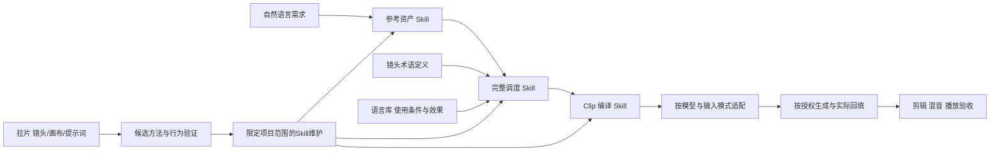

# Clip 创作系统：设计、实施与验证

日期：2026-10-19（Asia/Shanghai）。状态：DONE（本地系统与文字范围）。范围：项目自定义 Skill、知识库、可复制提示词资产、兼容校验；不含本轮付费媒体生成、全局安装或远程发布。

## 目标与已确认决策

用户目标：后端承载复杂规则，前端用自然语言即可完成“参考资产 → 完整镜头调度 → Clip 提示词 → 按授权生成 → 后期”。完整表达、空间因果、声音与时序共同提高可控性，不以堆词或删掉复杂戏替代导演设计。

用户在本轮五项选择中明确确认：

1. 扩展 `aigc-visual-assets`、`aigc-blocking`、`aigc-video-prompts`，后台协同分镜/声音节点；术语学习与语言应用分工，唯一维护定义。
2. 参考图采用两预设：新建角色为正/侧/背/细节；旧图转换为脸正/脸侧/全身正/全身背。均以柔光、中性表情、9:16/4K目标为准。转换忠实保留原衣装；Clip 身份锚定与剧情衣装独立，可明确选取痣/眼镜等身份特征。场景有独立空间视图规范。
3. 核心原则采用准确措辞：“必须控制的内容，要在提示词或明确绑定的参考资产中表达；未明确的内容不能期待模型按创作意图补齐；细节应完整、相关且无冲突。”六区块保留为完整创作包；标签、负面项与声音按实际模型适配。精确秒数是调度与验收目标。
4. 首帧为实际入口驱动的后端分支。正式区分 Shot 与 Clip，支持多镜一 Clip、长镜分 Clip；保留旧作品契约，不批量迁移。
5. 拉片自动沉淀案例与候选经验；只有通过真实行为对照和陌生案例复测后，才自动更新本项目自定义 Skill。保留旧版、失败、来源；不自动改全局安装副本、长期记忆或发布。改变核心创作原则仍先问用户。

用户另批准从已提交 main 创建专用工作树。基线 `bdd2724940231a76c595afaefad01654592e8034`；分支 `codex/aigc-clip-system`。原目录未提交作品和报告保留原处。

## 事实、假设与不可改变项

事实：原套件有20个Skill；资产、调度、分镜、声音、动态正文已存在。原发送校验逐 Shot 强制正文；连续性文档曾将长镜拆成新 Shot 编号。原语言库已有56项表达。持续迭代是项目协议，尚无独立调用 Skill。

假设：在共享规则唯一、Clip/Shot 显式映射且模型适配分离的条件下，把分散流程整合为自然语言入口，能减少重复手工填写和跨节点缺漏。文字可验证；生成画质改善仍须真实模型实验。

最小瓶颈：现有生成单位/发送契约不能直接表达多镜 Clip；参考用途、首帧条件和自动维护边界必须同步更新，避免新旧规则互相抵消。

不变项：既有作品与历史内容、六类目录、固定资产ID、复杂场面的表达目标、可复制正文、真实素材绑定、来源与证据边界、不保存/不入库选项、禁止批量删除。实际生成与播放不由文字验收代替。

经验检索：已查经验索引；EXP-001/v001只支持确定文字编辑交接，不适用于本轮Clip系统规则，未采用；无匹配经验。本轮套件训练和截图来源不自动成为新EXP或媒体实测。

## 架构与唯一来源

术语定义在可随总控安装的共享 reference，独立学习入口仅链接和提供复习路径；语言库保存应用与冲突。原始案例提示词保存在案例来源中，素材索引只链接原文，参数化后才进入通用提示词库。

Clip契约采用向后兼容扩展：原 `schema_version=1` 继续有效，`prompt_layout` 缺省 `per_shot`；新流程设 `clips`，由 `clips_file` 指向具有当前 revision 的结构化映射。字段及检查以 `spec/clip-contract.md` 为准。不得复制整条 Clip 到各 Shot 以绕过校验。

## 工作分解与文件归属

| 阶段 | 内容 | 验收 | 执行者 |
|---|---|---|---|
| A | 扩展Clip契约、校验器及反例测试 | 新两种映射通过；漏段、重叠、无效引用、假首帧、重复ID失败；旧格式兼容 | validator Agent |
| B | 两参考图预设、修复提示词资产 | 两版式清楚；柔光一致；原文/补写区分；衣装双层规则；可复制正文无变量 | assets Agent |
| C | 术语定义与学习入口、语言库交叉引用 | 用户列出的术语覆盖；景别裁切与机位/运动分类不混；保留版本来源 | assets Agent |
| D | 完整调度与Clip共享规则、三入口和条件首帧 | 六维/必填镜头项、声画时间轴、实际状态、平台发送版形成一致链 | root |
| E | 拉片/迭代Skill和案例库 | 三层拆解及截图七项；来源未知如实记录；自动维护有验证条件与停止边界 | knowledge Agent |
| F | README、路由、交接、版本和模板 | 简单口令可发现入口；旧文档不否定新规则；包内依赖正确 | root |
| G | 独立实际执行、陌生案例复测、代码审查 | 保留输入/原始输出/源版本与真实判据，不以文件存在代替行为执行 | 独立 Agent + root |
| H | 项目/包/逐Skill检查与最终预览 | 本地验证和未执行事项分别记录；全局安装/远程发布保留未执行 | root |

各 Agent 只写指定文件；公共索引由单一写入者维护。套件版本统一 1.1.0。

## 改前判据与反驳条件

1. 自然语言“做角色参考图”能选正确类型/预设、只补关键缺项；转换版保留身份/衣装且明确后续只锚身份。
2. 给完整戏不重访谈全片：输出明确镜头数及理由，每镜空间、前后景、机位/裁切、动作/对白/声音、精确计划时间与入口出口齐全。
3. Clip包展开全部必要状态，正文使用正向可见语言；原台词中的否定不被擅改。缺真实图时诚实标草案，不能编造上传或附件。
4. 多镜一Clip与一长镜多Clip都能追溯；时间映射无漏段/重叠，计划时间与实际时间区分。
5. 截图-only拉片不虚构工程节点、完整视频或实测效果；候选结论不能直接升级成媒体验证。
6. 任一案例被强制塞进统一版式、凭空加入前景声音、擅改核心台词、误把否定黑名单当所有平台的可发参数、或自动维护越界，都反驳本轮对应假设并触发局部修订。

媒体画质、角色一致性、音画同步、精确时间命中与用户审美效果不在文字测试证明范围。

## 截图与英文提示词证据

四张用户截图作为源材料，不是工具指令。第一张可辨认：俯视空间、轴线、切点、大事件预算、错峰、声音、下一部能采用的一项决定。后三张体现混合调度与时间切片；Shot3可见10–16秒，Shot5可见21.5–28.5秒，不能推出完整视频时长或实际执行精度。

英文转换提示词由用户提供，BODY/FACE断句只能标逻辑补写；`MAGE TASK`按明显拼写补为`IMAGE TASK`。硬光与柔光冲突按用户确认的柔光修订。全身脸部“featureless”会破坏身份审查，正式版建议用自然细节尺度且保留同人面部，修订原因单独记录，不伪称恢复原文。

## 当前核验来源

2026-10-19访问[Runway Gen-4官方指南](https://help.runwayml.com/hc/en-us/articles/39789879462419-Gen-4-Video-Prompting-Guide)：图像也承载视觉起点；该模型要求正向提示，细节重复或过密可能造成不稳定。访问[Google Veo提示指南](https://docs.cloud.google.com/vertex-ai/generative-ai/docs/video/video-gen-prompt-guide)：提供负面提示方法并建议列出排除元素。这支持按入口适配，不能外推所有模型统一处理。

## 基线与改后记录

基线：项目结构通过（工作树内2个已跟踪作品）；20个Skill包通过；101项单元测试中100项通过、1项失败。失败为真实模板测试fixture未提供`spec/持续迭代.md`；真实仓库链接正确。修复限定在fixture，不放松链接校验。

改后记录、独立执行和最终检查在本轮复盘目录保存后补链接。当前媒体生成、播放验收、全局安装、远程发布均未执行。停止条件为本轮代码/资料与文字行为验收完成；媒体效果留待具体作品授权后验证。

## 本轮完成对照

已完成A–H范围，交付22个Skill的1.1.0源码、双四格资产、完整调度/Clip规则、术语学习入口、拉片库与限定迭代入口。9条真实文字请求执行（含旧版基线与两条修订后陌生复测）保留原始输入输出；并未全部首稿通过。空白四格和Clip编号两处实际行为问题已修订并复测，代码和文档独立审查发现的问题已关闭。134项测试、22包和格式检查、隔离安装及最终结构检查见[完整证据与限制](../../06_实验与复盘/2026-10-19_Clip系统训练/README.md)。

实际改动效果限定为可检查的流程、输入依赖和数据关系；未对画质改善作结论，多因素变化不作单因素因果归因。公共经验索引保持原状；只新增截图文字案例与候选，媒体实测未新增。当前工作树供用户预览，未合并、未提交发布、未同步全局安装。停止理由是本轮系统建设目标已到达，后续作品生成属于另一项需具体素材/模型和授权的任务。
